# Authoring Reference

Everything you write to build a tutorial: the files, the frontmatter, the MDX components and the markers in your code. New here? Start with the [Quick start](quick-start.md), then read [How a tutorial works](#how-a-tutorial-works) below; the rest of the page is reference you can jump into from the table of contents.

Two complete examples live in the repository: [examples/oauth-pkce](../examples/oauth-pkce) (a web app with a live Preview) and [examples/rest-geocode](../examples/rest-geocode) (REST calls in cURL, Python and JavaScript with a Result pane). `npm create interactive-code-scroll@latest` writes a working starting point for every setup on this page ([Create a Project](cli.md#create-a-project)).

## How a tutorial works

A tutorial is two things side by side: explanations you write in MDX, and a real, runnable project. Each explanation block is a **step**. A step points at a **region** of a code file, and as the reader scrolls, the code panel shows that file and highlights the region.

<picture>
  <source media="(prefers-color-scheme: dark)" srcset="../site/public/screenshots/reading-oauth-dark.png">
  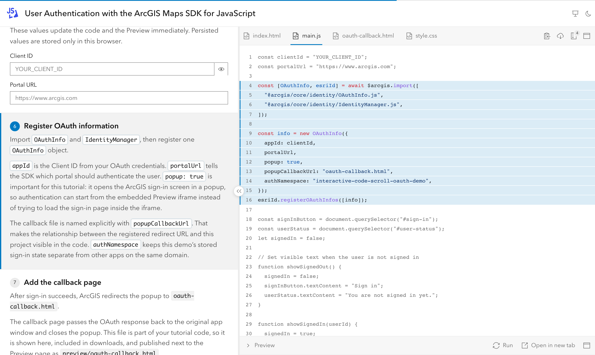
</picture>

The smallest tutorial is one MDX file with one step, and one code file with one region. Start with the explanation:

```mdx title="tutorial/tutorial.mdx"
---
title: Hello, page
---

<Step id="heading" file="index.html" region="heading">

## Add a heading

The `<h1>` is the first thing readers see.

</Step>
```

The step points at `index.html` and at its `heading` region, which the code file marks with two comments:

```html title="tutorial/code/index.html"
<!doctype html>
<html lang="en">
  <body>
    <!-- #region heading -->
    <h1>Hello</h1>
    <!-- #endregion heading -->
  </body>
</html>
```

That is all. When the reader reaches the step:

1. **The code panel follows the step.** It shows `code/index.html` and highlights the lines between `#region heading` and `#endregion heading`. The markers are comments, so the file stays valid HTML and never shows them to the reader. See [`<Step>`](#step) and [Regions](#regions).
2. **The Preview runs the code.** Because `code/` has an `index.html`, the tutorial is web code: the page runs it in a live [Preview](#preview) under the code panel. No setting is needed; the [`preview`](#frontmatter) field only changes how it is shown. Code that cannot run in the browser (a script, a REST call, a native app) shows its result in the [Result pane](#result-pane) instead.

From there, a tutorial grows with more steps and files, and with:

- **Editable values**: mark a string, number or boolean with `@var` and add a [`<VarField>`](#varfield); what the reader types replaces it in the code, the Preview and the downloads ([Variables](#variables)).
- **Images** instead of code for a step, such as setup screenshots ([Step examples](#step-examples)).
- **Results and requests** for code that runs outside the browser ([Result Pane](#result-pane), [HTTP Requests](#http-requests)).
- **Several languages** for the same steps ([Code Variants](#code-variants)).

Terms used on this page:

- **Web code**: a tutorial, or a [code variant](#code-variants), whose folder has an `index.html`. It gets the Preview; anything else gets the Result pane.
- **Text-only step**: a step with no `file`, `region` or `images`. It keeps the file on screen and clears the highlight.
- **Captured output**: a file under `output/` with the result the code produces (JSON, terminal text or an image), shown instead of running it.
- **Code variant**: the same steps in another programming language, picked with a switcher in the code header.

## Choose your setup

| You are teaching | Use | Read |
|---|---|---|
| A web app (HTML/JS, a browser SDK) | `code/index.html`; the Preview runs it | [Preview](#preview) |
| A script, a CLI or a native app | Captured results in `output/`, shown with `output=` | [Result Pane](#result-pane) |
| A REST API | `.http` files in `requests/`; readers press **Run request** | [HTTP Requests](#http-requests) |
| The same steps in several languages (cURL, Python, Node.js…) | Code variants: one folder per language under `code/` | [Code Variants](#code-variants) |
| Several languages with different explanations | One tutorial per language, linked as siblings | [Sibling tutorials](#sibling-tutorials) |
| Several tutorials on one site | A `tutorials/` folder with an index page | [Series Sites](#series-sites) |

The setups combine: a REST tutorial can have variants, captured outputs and requests at the same time, like [examples/rest-geocode](../examples/rest-geocode).

## Folder Structure

You do not need to create these folders by hand: `npm create interactive-code-scroll@latest` asks what you are teaching (web app, REST API, script or native app, in one or several languages), then writes the folders, a working example tutorial and the scripts to run it. See [Create a Project](cli.md#create-a-project).

The result is a folder with this shape:

```text
tutorial/
  tutorial.mdx
  code/
    index.html
    main.js
    style.css
  images/
    logo.svg
    screenshot.png
  embeds/            # optional: pages shown instead of code (e.g. a slide deck's build)
    oauth-slides/
      index.html
  output/            # optional: captured results for the Result pane
    geocode.json
  requests/          # optional: .http requests, zipped with the project
    geocode.http
  field-options/     # optional: option lists for <VarField options>
    portals.json
```

- `tutorial.mdx` contains [frontmatter](#frontmatter), prose and [MDX components](#components).
- `code/` contains the final runnable project files, with [code markers](#code-markers) in comments. Large projects can keep everything here (Gradle wrappers, asset catalogs, binaries) and pick the files that get tabs with the [`files`](#files-not-shown-in-tabs) frontmatter.
- `images/` contains the logo, screenshots and carousel images referenced by [steps](#step).
- `embeds/` (optional) contains pages a step shows in an iframe instead of code with `embed=`, published as they are: a small app, or the static build of a slide deck. See [Show an embedded page](#show-an-embedded-page-instead-of-code).
- `output/` (optional) contains captured results of code that cannot run in the browser, shown by steps with `output=` in the [Result pane](#result-pane).
- `requests/` (optional) contains [HTTP requests](#http-requests) (`.http` files) bound by steps with `request=`, plus supporting files; it is added to every ZIP.
- `field-options/` (optional) contains JSON option lists for [`<VarField options>`](#field-types); it is not published.

Files and folders whose name starts with `.` (`.env`, `.venv/`, `.github/`) are not part of the tutorial in any of these folders, and generated folders (`node_modules/`, `__pycache__/`, Python virtual envs, tool caches) are never read. You can run `npm install` or `python -m venv .venv` inside `code/`. See [Files left out of the tutorial](#files-left-out-of-the-tutorial).

The source code should be valid without InteractiveCodeScroll: every marker is a comment ([Code Markers](#code-markers)). Several tutorials in one repository use a `tutorials/` folder instead ([Series Sites](#series-sites)).

## Frontmatter

The YAML block at the top of `tutorial.mdx`. Only `title` is required; every other field has a default. The fields fall into three groups:

- [**Page**](#page): what the tutorial page shows around the steps.
- [**Code and Preview**](#code-and-preview): which files the code panel shows, how they are highlighted, and how web code runs.
- [**Series index and siblings**](#series-index-and-siblings): metadata that only a [series site](#series-sites) uses, for the index cards and the language menu.

```yaml title="tutorial/tutorial.mdx"
---
# Page
title: Build a checkout page
description: Accept a payment with a hosted checkout form.
theme: auto
logo: logo.svg
# Code and Preview
preview: both
console: false
codeWrap: false
# Series index and siblings
tags: [JavaScript, Payments]
level: Beginner
duration: 15 min
order: 1
---
```

### Page

| Field | Values | Default | Description |
|---|---|---|---|
| `title` | string | required | Rendered in the app header. Do not repeat it as an MDX `#` heading. |
| [`description`](#index-page) | string | none | One sentence: the page's meta description (search results, link previews) and, in a [series site](#series-sites), the index card text. |
| `theme` | `auto`, `light`, `dark` | `auto` | Author default. Viewer changes are remembered. |
| [`logo`](#folder-structure) | image path or `https://` URL | none | Relative to `images/`, or an absolute `https://` URL (not checked at build, and it needs the network when serving locally). Use a square SVG or a PNG of at least 512 x 512. It identifies the tutorial, so [series](#series-sites) index cards do not show it: they show [tag logos and variant links](#index-page). Pick colors that read on both light and dark backgrounds (for example a logo with its own background tile). |
| [`outline`](#step-outline) | boolean | the series' `index.mdx` one, else `true` | `false`: an `<Intro>` with no `file`, `images` or `embed` keeps the code panel instead of the [step outline](#step-outline). |
| [`completion`](#outro) | boolean | `true` | The closing panel after the last step: "Next" becomes "Finish" there and opens it. `false` removes it ("Next" stays disabled at the last step). |
| [`presentationUrl`](presenting.md#during-the-talk) | `http://` or `https://` URL | the series' `index.mdx` one, else Astro `site` + the tutorial's path, else the page URL | Where the QR code of the closing slide (presentation mode) points, e.g. the published copy when you present from `localhost`. `{slug}` is replaced. |
| [`feedbackUrl`](#outro) | `https://` or `mailto:` URL | the series' `index.mdx` one | "Send feedback" link in the closing panel and ["Ask the author"](#asking-about-a-selection) in the selection toolbar; none without a URL. `{slug}` and `{title}` are replaced (URL-encoded), e.g. `https://github.com/owner/repo/issues/new?title=Feedback:%20{title}`; `{context}`, `{selection}` and `{url}` carry a selection (empty in the closing panel). |
| [`ask`](#asking-about-a-selection) | list of `author`, `chatgpt`, `claude`, `{ label, url }`, or `false` | the series' `index.mdx` one, else `[author, chatgpt, claude]` | Actions of the selection toolbar, in menu order. `false` turns it off. |

### Code and Preview

| Field | Values | Default | Description |
|---|---|---|---|
| [`files`](#files-not-shown-in-tabs) | list of paths/globs | all text files: those the intro and steps show first, in step order, then the rest by path | Which `code/` files get tabs, in this order (`*` and `?` stay in one folder, `**` crosses folders). Other files still reach the ZIP and `preview/`; the ZIP button shows how many files the download contains, and its tooltip says how many are not shown in tabs. |
| [`include`](#files-left-out-of-the-tutorial) | list of paths/globs | none | Paths in `code/` starting with `.` or gitignored to publish anyway, e.g. `include: [".github/**", ".vscode/launch.json", ".gitignore"]`. Relative to `code/` (with `variants` too, e.g. `web/.github/**`). A pattern that matches nothing is a build error. |
| `codeWrap` | boolean | `false` | Wraps long code lines when `true`; preserves horizontal scrolling when `false`. |
| [`languages`](#syntax-highlighting) | map | none | Extension (no dot) → Shiki language id or `text`, e.g. `languages: { qmd: markdown }`. Overrides the built-in highlighting for that extension. |
| [`preview`](#preview) | `off`, `iframe`, `tab`, `both` | `both` | Controls the Preview panel and the open-in-tab button. |
| [`console`](#panel-and-console) | boolean | `false` | Adds Preview / Console tabs and captures live logs from the embedded app. Requires `preview: iframe` or `both` and web code. |
| [`variants`](#code-variants) | list | none | Code variants: the same steps in several languages. |
| [`otherVariantSteps`](#steps-across-variants) | `notice`, `hide` | `notice` | How steps limited with `only=` look to readers of another variant. |

### Series index and siblings

Ignored in a single-tutorial site, except `description`, which is also the page's meta description, and `updated`, `duration` and `level`, which also show on a line atop the explanations (hidden in presentation mode).

| Field | Values | Default | Description |
|---|---|---|---|
| [`tags`](#index-page) | list of strings | none | Series index card tags and filter values, e.g. `[REST, Python]`. No commas inside a tag. |
| [`level`](#index-page) | string | none | Series index card and the line above the explanations, e.g. `Beginner`; `<TutorialList level>` matches it exactly. `Beginner`, `Intermediate` and `Advanced` (any case) show one to three difficulty bars; other values a generic gauge icon. |
| [`duration`](#index-page) | string | none | Series index card and the line above the explanations (with a clock icon), e.g. `20 min`. |
| [`updated`](#index-page) | date `YYYY-MM-DD` | none | Last content update, e.g. `updated: 2026-10-16`, shown as "Updated Oct 16, 2026" on the series index card and above the explanations, before `duration` and `level` (hidden in presentation mode). Set by hand: it means the content was reviewed, not that a file changed. Quoted or not; an impossible date is a build error. |
| [`order`](#index-page) | number | none | Series index position: lower first; tutorials without it come after, by title. Also orders the [sibling](#sibling-tutorials) switcher. |
| [`family`](#sibling-tutorials) | string | none | Links sibling tutorials of a series site. Needs `familyLabel`. |
| [`familyLabel`](#sibling-tutorials) | string | none | This tutorial's name in the sibling menu, e.g. `Python`. Unique within the family. |
| [`next`](#outro) | tutorial slug, or `false` | the next tutorial in index order | "Next tutorial" link in the [closing panel](#outro), e.g. `next: display-map-python`. `false` shows none. A slug that is not another tutorial of the series is a build error. |

### Syntax highlighting

Highlighting happens at build time and is chosen by file extension. Other files show as plain text; the `languages` field maps any extension to a language.

| Languages | Extensions |
|---|---|
| Web | `js`, `mjs`, `cjs`, `jsx`, `ts`, `tsx`, `vue`, `html`, `css` |
| Data and config | `json`, `geojson`, `yaml`, `yml`, `toml`, `ini`, `xml`, `xaml`, `sql` |
| Docs and requests | `md`, `mdx`, `http` |
| Shell | `sh`, `bash`, `ps1` |
| Other languages | `py`, `kt`, `kts`, `gradle`, `swift`, `java`, `cs`, `cpp`, `h`, `hpp`, `qml`, `dart`, `lua` |

Fenced code blocks in `tutorial.mdx` (` ```js `) use the same light and dark themes as the code panel. To use other themes, set `markdown.shikiConfig.theme` or `themes` in `astro.config.mjs`: a project that sets either keeps its own.

Markdown tables in `tutorial.mdx` are styled to match the page: a header row over a rule, hairlines between rows and the first column as the row label. Long cell content wraps instead of widening the panel.

## Components

<picture>
  <source media="(prefers-color-scheme: dark)" srcset="../site/public/screenshots/area-explanations-dark.png">
  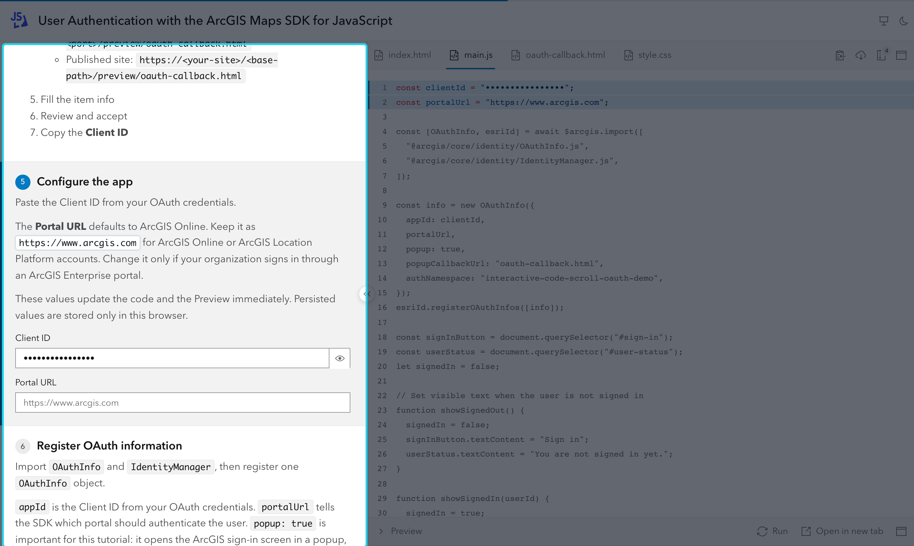
</picture>

Components render the explanations panel on the left: the tags you write in MDX.

| Component | Where | What it does |
|---|---|---|
| [`<Intro>`](#intro) | `tutorial.mdx` | Content before the first step: not numbered, no code focus. Can open on a file, show images or a page, and set the Preview / Result pane state. |
| [`<Step>`](#step) | `tutorial.mdx` | One step: its explanation and what the code panel shows. |
| [`<Outro>`](#outro) | `tutorial.mdx`, after the last step | Your own text in the closing panel ("what you learned", where to go next). |
| [`<VarField>`](#varfield) | `tutorial.mdx`, inside a step | A form field that edits a value in the code. |
| [`<Hint>`](#hint) | `tutorial.mdx`, inline | A short popover for a side note. |
| [`<TutorialList>`](#index-page) | `tutorials/index.mdx` | A section of tutorial cards on a series index. |
| [`<TutorialFavorites>`](#index-page) | `tutorials/index.mdx` | The reader's favorite tutorials on a series index, with a star on every card. |
| [`<TutorialFilter>`](#index-page) | `tutorials/index.mdx` | The search bar of a series index. |

Build errors name the file, line and column: `tutorial/tutorial.mdx:12:1 <Step> region "config" not found in code/main.js`. See [Validation](#validation) for the common ones.

### `<Intro>`

<picture>
  <source media="(prefers-color-scheme: dark)" srcset="../site/public/screenshots/area-intro-dark.png">
  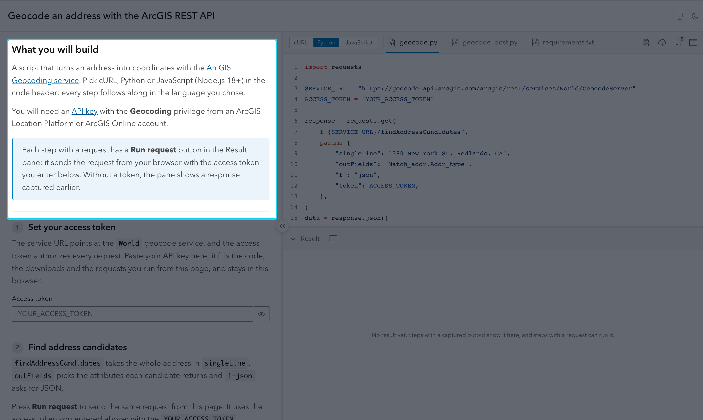
</picture>

Optional content before the first step. It is not numbered, does not count as a step and does not activate code focus.

```mdx title="tutorial/tutorial.mdx"
<Intro>

## Before you start

Install the prerequisites and keep this page open.

</Intro>
```

| Prop | Values | Default | Description |
|---|---|---|---|
| [`view`](#panel-and-console) | `preview`, `console`, `result` | keeps the current view | Selects a view and opens the lower pane while the intro is shown. Console requires frontmatter `console: true`. |
| [`collapsed`](#panel-and-console) | boolean | keeps the current state | `collapsed` folds the lower pane; `collapsed={false}` opens it without changing views. |
| [`panelHeight`](#panel-and-console) | number (15–85) | keeps the current size | Lower pane height as a percentage of the right column; applied on each entry. |
| [`maximize`](#maximize-from-a-step) | `code`, `panel`, `none` | keeps the current state | Same as on `<Step>`, applied when the intro is shown. |
| [`file`](#step) | path in `code/` (relative to each variant folder with [variants](#code-variants)) | the first tab | File tab shown while the intro is shown, with no focused lines: on load and each time the reader returns to it. Comes first in the tabs when frontmatter `files` does not set their order. Cannot be combined with `images` or `embed`. |
| [`images`](#show-images-instead-of-code) | array of paths in `images/` | none | Images shown instead of code while the intro is shown, as on `<Step>`. |
| [`embed`](#show-an-embedded-page-instead-of-code) | path in `embeds/` or `https://` URL | none | Page shown instead of code while the intro is shown, as on `<Step>`. Cannot be combined with `images`. |
| [`outline`](#step-outline) | no value | on when the intro sets no `file`, `images` or `embed` | The list of steps instead of code. Cannot be combined with `file`, `images` or `embed`. |

An intro with no `file`, `images` or `embed` shows the [step outline](#step-outline) next to it: the reader sees the plan of the tutorial before starting. Set frontmatter `outline: false` to keep the code panel there instead.

For a calm first screen, `<Intro collapsed>` starts with the pane collapsed; the first step that sets `view="preview"`, `view="console"` or `view="result"` opens it. To open on a file that no early step shows (a README, the finished app), use `<Intro file="README.md">`; with variants, every variant needs that file. Other `<Step>` props (`region`, `output`, `request`, `only`) are build errors on `<Intro>`: the intro comes before any code focus or result.

A tutorial without code (no `code/`, `preview: off`, every step with `images` or `embed`) can open on a picture or a title slide instead of an empty pane:

```mdx title="tutorial/tutorial.mdx"
<Intro images={["overview.png"]}>

## What you will learn

</Intro>

<Step id="why-pkce" embed="oauth-slides/#/2">
```

Moving from the intro to a step swaps the media as between steps: the same embedded page with another fragment (`oauth-slides/#/1` on the intro, `oauth-slides/#/2` on the first step) moves in place, without reloading.

When the intro shows nothing and there is nothing else to show next to it (no code tabs, no Preview and no step with `output` or `request`), it shows the media of the first step that has `images` or `embed`, so the page never opens on an empty pane. Entering that step keeps the media as it is. Tutorials with code, a Preview or a Result pane keep showing them next to the intro.

### `<Outro>`

Every tutorial ends with a closing panel after its last step: at the last step "Next" becomes "Finish", which scrolls to the panel (scrolling there does the same), and Back returns to the last step. The panel says "You've completed" and the tutorial title, and offers the next steps:

- **Next tutorial** (series only): frontmatter [`next`](#series-index-and-siblings), else the next tutorial in index order; none after the last one or with `next: false`.
- **Download code**: the ZIP of the code panel (active variant, form values applied).
- **Open preview**: with `preview: tab` or `both`.
- **All tutorials** (series only): back to the index.
- **Send feedback**: with a [`feedbackUrl`](#page), set per tutorial or for the whole series in `index.mdx`.

`<Outro>` adds your own text to the panel, between the heading and the actions. It takes no props, must come after the last `<Step>` and can be used once.

```mdx title="tutorial/tutorial.mdx"
<Outro>

You signed in with OAuth and showed a private layer. Next, store the token securely on a server.

</Outro>
```

Frontmatter `completion: false` removes the panel (then `<Outro>` is a build error). In presentation mode the panel is a full-screen [closing slide](presenting.md#during-the-talk): the `<Outro>`, the next tutorial and a QR code of the tutorial's URL instead of the reader actions.

### Asking about a selection

Readers who select text in the explanations (two words or more) or in the code panel get a small toolbar over the selection:

- **Ask the author** opens your [`feedbackUrl`](#page) with the selection's context, so the question reaches you (for example as a GitHub issue).
- **Ask AI** opens an AI assistant with a ready prompt: the tutorial title, the step, a link back to the selection and the selected text (from the code panel: the file, its lines and the code, with [secret](#varfield) values masked). The prompt is also copied to the clipboard, because the assistants' prefill links are not official and may change.

The link back opens the step and highlights the selected text ([text fragment](https://developer.mozilla.org/en-US/docs/Web/URI/Reference/Fragment/Text_fragments)). The toolbar shows when the selection ends, not while dragging, and never on touch screens or in presentation mode; Esc hides it.

Put `{context}` in `feedbackUrl` to receive the selection as Markdown (link, step, quoted text), or `{selection}` and `{url}` separately. A template without them still opens, without the selection. The closing panel's "Send feedback" fills them empty.

```yaml title="tutorial/tutorial.mdx (or tutorials/index.mdx for the whole series)"
feedbackUrl: https://github.com/owner/repo/issues/new?title=Question:%20{title}&body={context}
ask: [author, chatgpt, claude, { label: "Esri's Ask AI", url: "https://developers.arcgis.com/" }]
```

`ask` lists the toolbar's actions in order; `false` turns the toolbar off. A tutorial's `ask` replaces the series list. The default is `[author, chatgpt, claude]`, where `author` is left out without a `feedbackUrl` (listing `author` yourself without one is a build error). A `{ label, url }` entry adds another assistant (`https://` only): `{prompt}` in `url` is replaced with the prompt, and without it the page opens as is and the reader pastes the copied prompt (the menu marks it with a copy icon). With one assistant the toolbar shows "Ask <label>" instead of a menu.

### `<Step>`

<picture>
  <source media="(prefers-color-scheme: dark)" srcset="../site/public/screenshots/area-step-dark.png">
  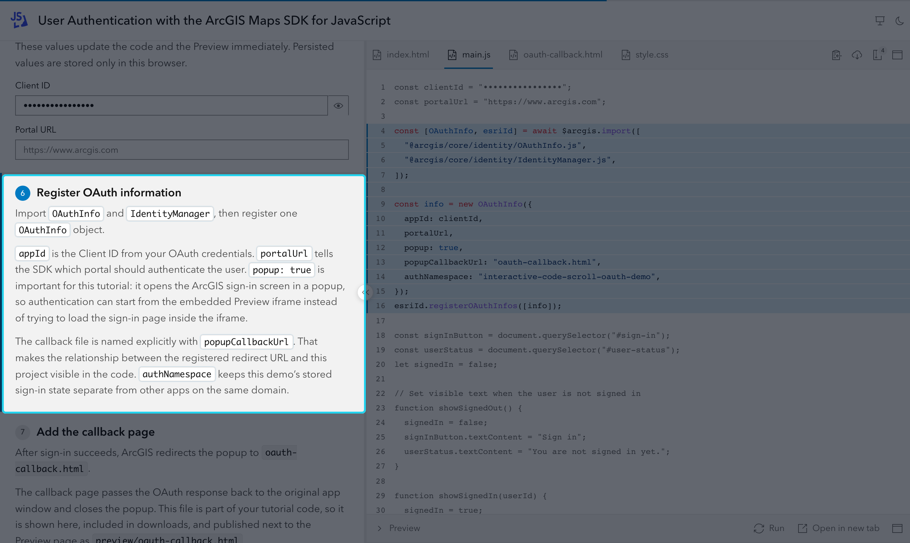
</picture>

The main tutorial block: a heading, the explanation, and what the code panel and the pane under it show while the step is active.

```mdx title="tutorial/tutorial.mdx"
<Step id="configure" file="main.js" region="config" collapsed>

## Configure the app

Explain the change here.

</Step>
```

| Prop | Values | Default | Description |
|---|---|---|---|
| `id` | lowercase letters, digits, `-` | required | Unique per tutorial. The step's URL is `#id` ([deep links](presenting.md#before-the-talk)). |
| [`file`](#folder-structure) | path | current file | File to show, relative to `code/` (to the variant folder with `variants`). |
| [`region`](#regions) | region id, or a [JSON Pointer](#json-regions) | none: no highlight | Region to highlight in `file`. With `variants`, a region id alone is enough: it names one file per variant. A value starting with `/` highlights a member of a `.json` `file` (`/name../scripts`: a range of members). |
| [`images`](#show-images-instead-of-code) | `{["a.png", "b.png"]}` | none | Images in `images/` shown as a carousel instead of code. Must be a static array. |
| [`embed`](#show-an-embedded-page-instead-of-code) | path in `embeds/` or `https://` URL | none | Page shown in an iframe instead of code, e.g. `embed="oauth-slides/#/3"`. Cannot be combined with `images`. |
| [`output`](#result-pane) | file name in `output/` | none | Captured result shown in the Result pane, e.g. `output="geocode.json"`. |
| [`request`](#http-requests) | request names | none | Space-separated `# @name`s from `requests/`, e.g. `request="geocode-get geocode-post"`; the first is the default. |
| [`view`](#panel-and-console) | `preview`, `console`, `result` | keeps the current view | Selects a view and opens the lower pane when the step activates. Console requires frontmatter `console: true`. |
| [`collapsed`](#panel-and-console) | boolean | keeps the current state | `collapsed` folds the lower pane; `collapsed={false}` opens it without changing views. |
| [`panelHeight`](#panel-and-console) | number (15–85) | keeps the current size | Lower pane height as a percentage of the right column; applied on each entry. |
| [`maximize`](#maximize-from-a-step) | `code`, `panel`, `none` | keeps the current state | Maximizes the code area (code, images or embedded page) or the pane under it (Preview or Result pane); `none` restores the layout. |
| [`only`](#steps-across-variants) | variant ids | all variants | With `variants`: space-separated ids the step applies to, e.g. `only="python curl"`. |
| [`outline`](#step-outline) | no value | none | The list of steps instead of code, e.g. for a recap halfway through. Cannot be combined with `file`, `region`, `images` or `embed`. |

The step's heading is also its title in the [step index](#step-index) and the [step outline](#step-outline); a step without a heading is listed as "Step N". Keep headings short.

A [text-only step](#how-a-tutorial-works) keeps the current file visible and clears any previous region focus.

#### Step examples

##### Highlight a code block

```mdx title="tutorial/tutorial.mdx"
<Step id="config" file="main.js" region="config">
```

Without `region`, the whole file shows with no highlight. Without `file`, the step keeps the file on screen.

A step that shows another file than the step before it names that file in a chip on its heading row. When the reader reaches it, the new file tab flashes and the code fades in before scrolling to the region, so the switch is hard to miss; screen readers hear "Showing <file>". Deep links and tab clicks switch without the animation, and reduced motion drops it.

##### Show images instead of code

```mdx title="tutorial/tutorial.mdx"
<Step id="register-app" images={["1-create-item.png", "2-copy-client-id.png"]}>
```

Paths are relative to `images/`. Step keys page through the images before moving to the next step; clicking one opens a full-screen viewer. The value must be a JSX array written in place (`images={[…]}`), not a string or a variable. The [intro](#intro) takes the same prop, shown before the first step.

##### Show an embedded page instead of code

```mdx title="tutorial/tutorial.mdx"
<Step id="why-pkce" embed="oauth-slides/#/3">
```

Some concepts are easier to explain with a small app or a few slides than with code. `embed` shows a page in an iframe in place of the code:

- A path in `embeds/`: a file, or a folder with an `index.html`. Files there are published as they are and work offline. A `?query` or `#fragment` is kept, so a hash-routed slide deck opens at a given slide.
- An `https://` URL. Some sites refuse to be shown in an iframe (`X-Frame-Options` or CSP `frame-ancestors`); the build cannot detect it, so check the step in the browser. The **Open in new tab** action over the page is the fallback.

Consecutive steps (or the [intro](#intro) and the first step) that embed the same page with a different fragment (`oauth-slides/#/3`, then `oauth-slides/#/4`) move it in place, without reloading it. Inside a page from `embeds/`, PageDown/PageUp (what clickers send) still move steps and Esc restores a maximized pane; arrows stay with the page. Inside an external page the browser gives the keys to that page: click the explanations to take them back.

For a [Slidev](https://sli.dev) deck, set `routerMode: hash` in its headmatter, build it with relative paths and copy the result into `embeds/`:

```sh
npx slidev build --base ./ --out ../tutorial/embeds/oauth-slides
```

If `astro check` reports the deck's bundled JavaScript, exclude the folder in `tsconfig.json`: `"exclude": ["dist", "**/embeds/**"]`.

##### Show a saved result

```mdx title="tutorial/tutorial.mdx"
<Step id="results" region="results" output="candidates.txt">
```

The file lives in `output/` (or `output/<variant id>/` for one language). See [Result Pane](#result-pane).

##### Let readers run a request

```mdx title="tutorial/tutorial.mdx"
<Step id="request" region="request" output="geocode.json" request="geocode-get">
```

Adds a **Run request** button that sends `# @name geocode-get` from `requests/`. The captured `output` is shown until the reader runs it, and again if the network fails. See [HTTP Requests](#http-requests).

##### Make a result fill the screen

```mdx title="tutorial/tutorial.mdx"
<Step id="run-it" output="geocode.json" maximize="panel">…</Step>
<Step id="back" maximize="none">…</Step>
```

See [Maximize from a step](#maximize-from-a-step).

##### Recap the plan halfway through

```mdx title="tutorial/tutorial.mdx"
<Step id="recap" outline>
```

See [Step outline](#step-outline).

##### Apply a step to some languages only

```mdx title="tutorial/tutorial.mdx"
<Step id="install" file="requirements.txt" only="python">
```

See [Steps across variants](#steps-across-variants).

### `<VarField>`

<picture>
  <source media="(prefers-color-scheme: dark)" srcset="../site/public/screenshots/area-varfield-dark.png">
  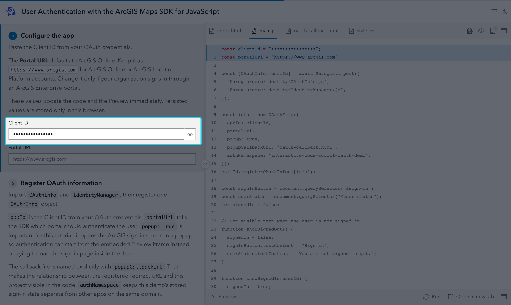
</picture>

A form field linked to an [`@var` marker](#variables) in code. What the reader types replaces the marked literal in the code panel, the Preview, the ZIP and the [requests](#request-runner); an empty field restores the literal, which is the default value. The field follows the var's type: a text input for a string, a number input for a [number var](#number-and-boolean-variables) and a switch for a boolean one; `type` picks [another field](#field-types).

```mdx title="tutorial/tutorial.mdx"
<VarField name="clientId" label="Client ID" secret persist />
<VarField name="portalUrl" label="Portal URL" placeholder="https://example.com" persist />
```

Consecutive `<VarField>`s form a group laid out in as many columns as the explanations panel fits (one at the default split; more when the reader widens it). A `textarea` takes the whole row; prose between fields starts a new group.

| Prop | Values | Default | Description |
|---|---|---|---|
| [`name`](#variables) | variable name | required | An `@var` name in a code file, or a file variable in a [`.http` file](#http-file-variables). |
| [`json`](#json-variables) | `"<file>#<pointer>"`, or an array of them | none | Makes a value of a JSON file under `code/` this var. |
| `label` | string | required | Visible field label. |
| [`type`](#field-types) | `text`, `textarea`, `select`, `radio`, `combobox` | from the var | The kind of field. |
| [`options`](#field-types) | array, or a file in `field-options/` | none | Choices of `select`, `radio` and `combobox`. |
| `layout` | `vertical`, `horizontal` | `vertical` | How `radio` buttons are laid out: stacked, or in a row. `radio` only. |
| `placeholder` | string | none | Input hint. Does not change the code default. Not for boolean vars, `select` or `radio`. |
| `secret` | flag | off | Text fields of string vars only. Masks the input, the value in the code and the [request line](#request-runner) until the reader reveals it. |
| `persist` | flag, or `"tutorial"` | off | Stores the value in `localStorage`. `persist` shares it with every tutorial of a [series site](#series-sites) (a key is entered once per site); `persist="tutorial"` keeps it to this tutorial. On a single-tutorial site both behave the same. |

#### Field types

`type` changes the field; the value still replaces the literal in the code:

| `type` | Field | Vars |
|---|---|---|
| `text` | One-line input (default for strings) | string |
| `textarea` | Multi-line input; line breaks are written as `\n` in the code | string |
| `select` | Dropdown | string, number |
| `radio` | Radio buttons | string, number |
| `combobox` | Dropdown with search, for long lists; can be cleared when the default is `""` | string, number |

```mdx title="tutorial/tutorial.mdx"
<VarField name="portal" label="Portal" type="select" options="portals.json" />
<VarField name="slot" label="Key slot" type="radio" layout="horizontal" options={[{ value: 1, label: "Slot 1" }, { value: 2, label: "Slot 2" }]} />
<VarField name="privilege" label="Privilege" type="combobox" options={["premium:user:basemaps", "premium:user:geocode"]} />
<VarField name="description" label="Description" type="textarea" />
```

- `options` is a static array of strings, numbers or `{ value, label }` objects, or the name of a JSON file with such an array in `field-options/` (for long lists, or lists shared by several fields):

  ```json title="tutorial/field-options/portals.json"
  [
    { "value": "https://www.arcgis.com", "label": "ArcGIS Online" },
    { "value": "https://location.arcgis.com", "label": "ArcGIS Location Platform" }
  ]
  ```

- The code default must be one of the option values (a number var needs number values); a `combobox` may also start empty when the default is `""`.
- Number vars get a number input and boolean vars a switch without `type`.

### `<Hint>`

<picture>
  <source media="(prefers-color-scheme: dark)" srcset="../site/public/screenshots/area-hint-dark.png">
  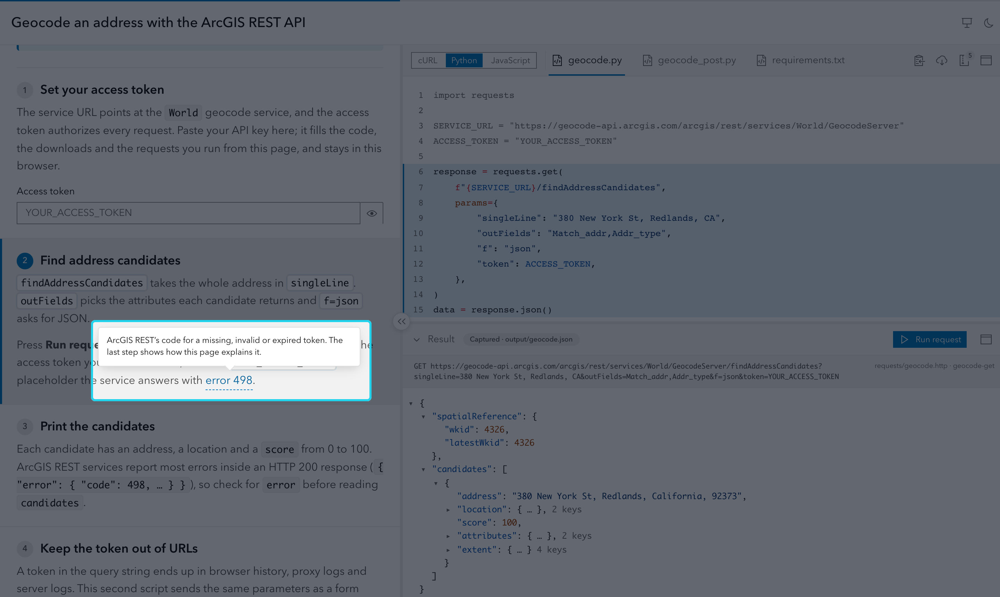
</picture>

A short inline clarification with a hover/focus popover.

```mdx title="tutorial/tutorial.mdx"
The Preview runs from a <Hint id="same-origin" label="same-origin page">A real URL under the generated site.</Hint>.
```

| Prop | Values | Default | Description |
|---|---|---|---|
| `id` | lowercase letters, digits, `-` | required | Unique per tutorial. |
| `label` | string | required | The underlined text in the sentence. |

The content between the tags is the popover. Use hints for brief side notes; use regular prose or `<details>` for essential or longer content.

Leave a blank line after `<summary>` and before `</details>`, so the content is parsed as Markdown; otherwise MDX puts `<summary>` inside a paragraph and the build warns:

```mdx
<details>
<summary>Why register more than one behavior?</summary>

`registerOAuthInfos()` accepts an array.

</details>
```

### Listen to a tutorial

When the browser supplies a voice matching the page language, **Listen** appears next to the step-position button between Back and Next. The audio row stays hidden until Listen is pressed. It reads the current introduction, step or closing panel's headings and prose (including `<Outro>`), leaving out form fields, controls and code blocks. Inline code is read as part of its sentence. A `<Hint>` term is read in its sentence; the hint text follows that sentence after a short pause, with its popover open. A collapsed `<details>` reads its summary, then opens and reads its content. Add `data-speech="skip"` to leave an element out of narration, for example `<details data-speech="skip">` around a solution. No author configuration or TTS service is required.

After starting, the bar offers Pause / Resume, Stop, speed and settings for the voice and **Advance automatically** (off by default). Alt+Shift+L starts, pauses or resumes outside editable fields. Stop or pressing Listen again closes the audio row. Voice, speed and automatic advance are remembered per site in localStorage; returning never starts playback automatically. Available voices come from the browser; voices marked **online** may require a connection.

The current sentence is highlighted; voices that emit word boundaries refine it to the current word. Browsers without custom text highlights mark the current paragraph instead. The reader's selection and links remain intact. Resume repeats the latest word, or the current sentence if the voice supplies no word boundaries.

Automatic advance waits briefly after the step, then reads the next reachable step, keeping the code panel synchronized. It skips hidden steps and does not page through carousels or control slides inside embedded pages. After the last step it opens the closing panel and reads its heading and `<Outro>`, then stops. With `completion: false` it stops at the last step. Action buttons, next-tutorial recommendations and QR content are excluded, and it never opens another tutorial. Changing steps manually follows the new step while playing; while paused, it waits for Resume. Using a field or running a request pauses narration. Narration keeps playing in presentation mode, where Alt+Shift+L starts it. Hiding the explanations pauses it.

### Step index

Readers can open a list of the tutorial's steps from the position between Back and Next ("5 / 10", with a list icon). It shows each step's number and heading, a check on the steps before the current one, and the current one marked; clicking a step jumps to it. On phones it opens as a bottom sheet. In [presentation mode](presenting.md#during-the-talk) the header's "Step 5 of 10" opens it as a large centered list, also with `O`. Nothing to write: the list comes from your steps and their headings. Steps for other [variants](#steps-across-variants) are dimmed with their variant names (`otherVariantSteps: notice`) or left out (`hide`).

### Step outline

The same list can fill the code area as an agenda, headed "Steps": next to an `<Intro>` that shows nothing else (by default), or on a step with `outline`, such as a recap halfway through. It follows the reader (checks, current step) and each item jumps to its step. The language switcher, file tabs and ZIP button stay; a click on a tab shows that file until the next step. In a tutorial without code it fills the media panel. A long list takes up to four columns to fit; in presentation mode the text is larger.

```mdx title="tutorial/tutorial.mdx"
<Intro>

## What you will build

</Intro>

…

<Step id="recap" outline>

## Where we are

Half of the app is in place. Next, sign-in.

</Step>
```

Frontmatter `outline: false` (per tutorial, or for a whole series in `tutorials/index.mdx`) keeps the code panel next to an intro without media; `<Intro outline>` and `<Step outline>` still show it.

## Code Markers

<picture>
  <source media="(prefers-color-scheme: dark)" srcset="../site/public/screenshots/area-code-dark.png">
  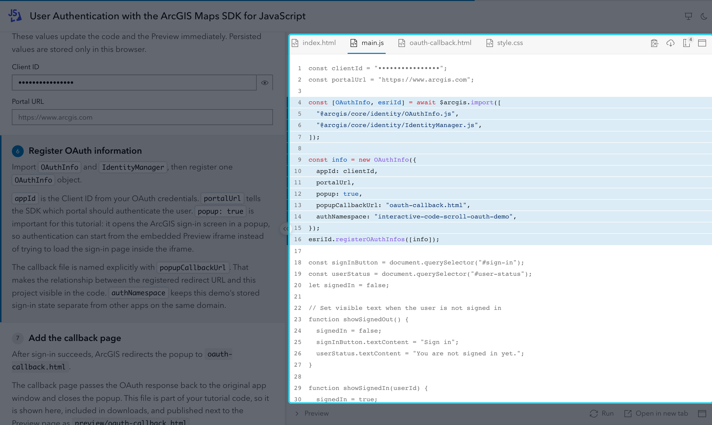
</picture>

The code panel on the right shows your files. Markers are comments in those files that tell it what to highlight and what readers can edit; they never reach the reader or the downloads.

### Regions

Wrap the lines a step highlights in `#region <id>` and `#endregion <id>` comments:

```js title="tutorial/code/main.js"
// #region config
const title = "Checkout";
// #endregion config
```

Use the comment syntax of the file:

```html title="tutorial/code/index.html"
<!-- #region app -->
<main id="app"></main>
<!-- #endregion app -->
```

```css title="tutorial/code/style.css"
/* #region layout */
main {
  display: grid;
}
/* #endregion layout */
```

```sh title="tutorial/code/setup.sh"
# #region setup
npm init -y
npm install -D astro interactive-code-scroll
# #endregion setup
```

```yaml title="tutorial/code/config.yaml"
# #region frontmatter
title: My Tutorial
preview: tab
# #endregion frontmatter
```

A few languages also accept their own region style. Each one works only in its own file type, so the same text in any other file stays an ordinary comment:

| Files | Style |
|---|---|
| `.cs` | C# `#region id` / `#endregion` |
| `.py` | `# region id` / `# endregion` (VS Code folding style) |
| `.sql`, `.lua` | `-- #region id` / `-- #endregion` |

```python title="tutorial/code/geocode.py"
# region geocode
response = requests.get(url, params=params)
# endregion geocode
```

Rules:

- Region ids are unique per file.
- Regions may nest.
- Empty regions are errors.
- A closing id, when present, must match the opened region.

#### JSON regions

JSON has no comments, so a `.json` file cannot hold `#region`. Tools such as npm read files like `package.json` from `code/`, so they must stay valid JSON. Instead, the step's `region` is a [JSON Pointer](https://datatracker.ietf.org/doc/html/rfc6901) to the member to highlight:

```json title="tutorial/code/package.json"
{
  "name": "my-app",
  "scripts": { "start": "node server.js" },
  "dependencies": {
    "express": "^5.1.0",
    "dotenv": "^17.2.0"
  }
}
```

```mdx title="tutorial/tutorial.mdx"
<Step id="install" file="package.json" region="/dependencies">
```

- The highlight runs from the member's key line (`"dependencies": {`) to the line that closes its value. An array item (`/keywords/0`) highlights its value.
- A range `first..last` highlights sibling members, from the key of the first to the end of the last, with everything in between: `region="/name../scripts"`. Both pointers must be in the same object or array, the first one before the other. The range is split at the first `../`, so a single pointer cannot contain `../`.
- The pointer walks objects by key and arrays by index; a key with `/` or `~` is written `~1` / `~0`, as in [JSON variables](#json-variables).
- `file` is required and must be a `.json` file. With [variants](#code-variants), the pointer must exist in the file of every variant the step covers (or set `only`).
- The highlight follows the key when the file changes. A renamed or removed key fails the build at the `<Step>`, with the MDX file and line.
- YAML, TOML, INI and `.env` files accept `#` comments, so they use [`# #region`](#regions) markers.

### Variables

Put `@var <name>` in a comment on the same line as a string, number or boolean literal. The literal is the default value; a [`<VarField>`](#varfield) with the same `name` lets readers change it.

```js title="tutorial/code/main.js"
const tutorialTitle = "InteractiveCodeScroll"; // @var tutorialTitle
```

Rules:

- `@var` targets the first string literal on its line; on a line without one, the first [number or boolean](#number-and-boolean-variables).
- `@var <name>:string`, `:number` or `:boolean` picks the first literal of that type instead (for example a number on a line that also has a string).
- In YAML, a quoted key (`"name": "value"`) is never the target.
- An empty string (`""`) is a valid default for an optional value: the field starts empty and the code shows what the reader types.
- Use one `@var` per line.
- Variable names are unique per file.
- The same variable may appear in several files (for example a token in `main.py` and `MainActivity.kt`); one form field then fills all of them. Every occurrence must have the same type and default literal, or the build fails and lists each file. Booleans compare without case, so `true` in JavaScript and `True` in Python are the same default.
- SQL and Lua files also accept `-- @var name` comments.

Values are escaped for the file type and quote style, so whatever the reader types keeps the code valid:

| Files | Escaping |
|---|---|
| JS/TS, JSON, CSS, Python, Swift, Java, C#, C++, QML, YAML/TOML double quotes | Backslash escapes (`\"`, `\\`, `\n`) |
| Kotlin, Dart, Gradle/Groovy | Backslash escapes plus `\$`, so values never start a string template |
| Shell (`.sh`, `.bash`) | Double quotes escape `\ " $` and backticks; single quotes use `'\''` |
| PowerShell (`.ps1`) | Double quotes use backtick escapes; single quotes double the quote |
| SQL, YAML single quotes | The quote is doubled (`''`) |
| HTML/XML/XAML (`<!-- @var -->`) | Attribute entities (`&quot;`, `&amp;`, `&lt;`) |

Literals that cannot hold an arbitrary value are build errors: Python f-strings, raw strings and triple-quoted strings, and TOML literal strings (`'...'`). Use a plain string instead.

#### Number and boolean variables

A number or boolean literal is replaced as a literal, so the code needs no conversion such as `Number(...)`:

```python title="tutorial/code/report.py"
MAX_RESULTS = 10  # @var maxResults
VERBOSE = False  # @var verbose
```

- Numbers: integers, decimals and exponents (`30`, `-1.5`, `2e3`). Suffixed or hex literals (`30L`, `0x1F`) are not numbers here. A value that is not a number writes the default instead, so the code stays valid.
- Booleans: `true`/`false`, `True`/`False`, `TRUE`/`FALSE` and PowerShell `$true`/`$false`. The value keeps the spelling of each file's literal: one switch writes `true` in `main.js` and `True` in `report.py`.

#### JSON variables

JSON has no comments, so a `.json` file cannot hold `@var`. Instead, the `<VarField>` names the value with a [JSON Pointer](https://datatracker.ietf.org/doc/html/rfc6901) after the file path, and the file under `code/` stays valid JSON that runs without the framework:

```json title="tutorial/code/key-config.json"
{
  "title": "My API key",
  "expiration": { "days": 30 },
  "generateToken1": true
}
```

```mdx title="tutorial/tutorial.mdx"
<VarField name="keyTitle" label="Key name" json="key-config.json#/title" />
<VarField name="days" label="Expiration (days)" json="key-config.json#/expiration/days" />
<VarField name="token1" label="Generate token 1" json="key-config.json#/generateToken1" />
```

- The path is relative to `code/`. The pointer walks objects by key and arrays by index (`/referrers/0`); a key with `/` or `~` is written `~1` / `~0`.
- The value must be a string, number or boolean; its type and default come from the JSON. Arrays, objects and `null` are build errors.
- Values keep the JSON valid: strings are escaped, and a number or boolean that does not fit writes the default.
- A JSON var follows the [rules](#variables) of any var: the file must be shown in tabs, and a name also marked with `@var` elsewhere needs the same type and default. For [variants](#code-variants) with one JSON file each, pass an array: `json={["js/config.json#/days", "py/config.json#/days"]}`.

### `.http` file variables

In `.http` files (VS Code REST Client / JetBrains HTTP Client syntax), every file variable line is a variable with the rest of the line as its default. No `@var` marker is needed. This applies to `.http` files in `code/` and in [`requests/`](#http-requests); a `<VarField>` can target either, and a var used in both needs the same default:

```http title="tutorial/requests/search.http"
@accessToken = YOUR_ACCESS_TOKEN

GET https://example.com/search?token={{accessToken}}
```

Values are inserted as typed, with line breaks removed.

## Preview

<picture>
  <source media="(prefers-color-scheme: dark)" srcset="../site/public/screenshots/area-preview-dark.png">
  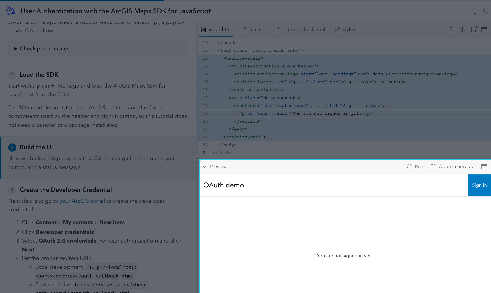
</picture>

Web code runs in a live Preview under the code panel. It needs `code/index.html` (with code variants, see [Preview and downloads](#preview-and-downloads)). The generated site publishes every file under `code/` next to the Preview page, with markers stripped, so relative links such as `./main.js` or `./oauth-callback.html` keep working.

Form values reach every file the Preview loads, not only the scripts and stylesheets `index.html` links:

- **Imported modules and fetched files**: a module that `index.html` (or another module) imports, such as a shared `./config.js`, and a file the code reads with `fetch()` run with the current values.
- **Other HTML pages**: any other `.html` file, such as an OAuth callback page opened in a popup, runs from its own URL under `preview/` with the current values, so `redirect_uri` and `window.opener` keep working. Opened without the tutorial (another browser, a cleared site storage), it runs with the code defaults.

Files read in other ways (a `Worker`, `XMLHttpRequest`, a CSS `@import`) get the code defaults.

The [`preview`](#frontmatter) frontmatter field picks the mode:

| Value | Reader gets |
|---|---|
| `both` (default) | The embedded Preview and an open-in-tab button |
| `iframe` | The embedded Preview only |
| `tab` | The open-in-tab button only |
| `off` | No Preview; `code/index.html` is not required |

Form changes refresh the Preview after a short debounce; the Run button refreshes it manually. A step's or intro's [`view`](#panel-and-console) selects content and opens the pane; `collapsed` folds it. The `both` mode means iframe plus new tab, not Preview plus Console.

### Panel and Console

**Available since 0.2.0-beta.10.** Upgrading an existing tutorial? See the [panel API migration](upgrade.md#panel-api-migration-020-beta10).

<picture>
  <source media="(prefers-color-scheme: dark)" srcset="../site/public/screenshots/console-web-dark.png">
  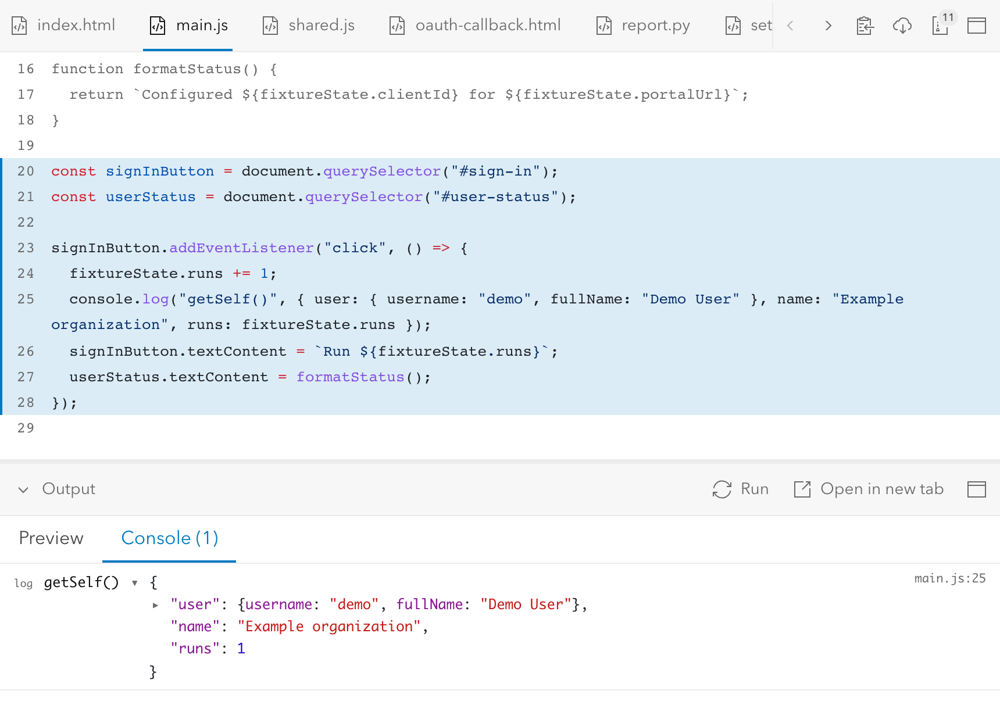
</picture>

Choose what the tutorial offers in its frontmatter, then choose what each step shows.

**Preview only (the default):** the running app appears under a **Preview** header, without tabs or console capture.

```yaml
preview: iframe
console: false
```

**Preview and Console:** opt in to live capture. The header becomes **Output**, with **Preview** and **Console** tabs. Only one is visible at a time; the app keeps running while Console is selected. This works in dev and the built static site.

```yaml
preview: iframe
console: true
```

`console` defaults to `false`. Set it to `true` with `preview: iframe` or `both` and web code (`index.html` in at least one variant). Standalone tabs (`preview: tab`) use the browser's native console.

`view` on `<Step>` or `<Intro>` selects content and opens the pane when that block becomes active:

| Value | Behavior |
|---|---|
| `preview` | Show the running app. Works with or without Console enabled. |
| `console` | Show the app's captured logs. Requires frontmatter `console: true`. |
| `result` | Show the Result pane for non-web code with captured output or HTTP requests. |
| omitted | Keep the reader's selected view and expanded/collapsed state. |

Visibility is separate: `collapsed` (or `collapsed={true}`) folds the whole pane to its header, keeping the selected view. `collapsed={false}` opens it without switching views. Omit both props to preserve the current state. Do not combine `view` with `collapsed` set to true: one opens the pane and the other folds it.

Use `panelHeight={30}` on a `<Step>` or `<Intro>` to reserve 30% of the right column's height for the lower pane (its header and splitter included). This is a share of the space the code and pane occupy together, below the page header, rather than `vh` of the whole browser window. The remainder holds the code and its header. Static numbers from 15 to 85 are accepted, matching the splitter's limits; quoted strings, expressions such as `height + 5`, and out-of-range values are build errors. A tutorial must have an embedded Preview or a step with a result.

The height applies each time that block becomes active. It does not open the pane or select a view by itself: combine it with `view="console"`, `view="preview"`, `view="result"` or `collapsed={false}` as needed. Omitted keeps the current size. Readers can still drag the splitter or use its arrow keys; only their manual adjustments update the remembered size. Author heights never overwrite that preference. Opening or resizing the pane reveals the active code region when it fits; a taller region shows its start. Between size changes, readers can scroll the code freely.

```mdx
<Intro view="preview" panelHeight={40}>…</Intro>

<Step id="inspect-output" file="main.js" region="response"
      view="console" panelHeight={30}>
  Inspect the response alongside the code.
</Step>
```

On phones (portrait and compact touch landscape), the pane keeps its header and opens maximized; `panelHeight` does not change that behavior. Maximized panes also fill the window regardless of this height; restoring the desktop layout uses the requested size.

The initial web view is Preview, expanded. Use `<Intro collapsed>` to start folded. Readers can always change tabs themselves; the next block with `view` selects its view again. In a tutorial mixing web and non-web variants, a view applies to variants that have that pane; use `only=` for a step that belongs to one kind only.

For a tutorial with `console: true`:

```mdx
<Intro collapsed>
  ## Explore an API response
</Intro>

<Step id="run" file="main.js" region="sign-in" view="preview">
  ## Run the example
  Interact with the Preview to make the request.
</Step>

<Step id="inspect" file="main.js" region="get-self" view="console">
  ## Inspect the response
  Expand the object logged by the app.
</Step>

<Step id="continue" file="main.js" region="search" view="preview">
  ## Continue in the app
</Step>
```

For example, the app's `console.log("getSelf()", self)` produces a labeled entry with a collapsed one-line preview such as `{user: {…}, name: "Example"}`. Click its arrow to explore nested objects; arrow keys navigate the tree. Console captures `log`, `info`, `warn` and `error` in chronological order, with severity indicators and DevTools-style colors for keys, strings, numbers and literals, including collapsed previews. Each entry shows its source file and line when the browser provides a usable caller location (for example `main.js:27`). Local scripts inlined into the Preview and modules replaced by form values keep a source name; line numbers match the cleaned code displayed by the tutorial. Locations are best-effort (`Error.stack` differs across browsers); unavailable locations are omitted. Original messages still appear in browser DevTools.

Selecting a step **does not execute its code region**. If the interaction has not happened yet, its log will not exist. The iframe first starts when the pane opens or Run is pressed. After that, switching tabs, steps, collapsing or maximizing preserves the running app and the log. Run, reload and variant changes reset the displayed messages. Form changes still reload the app after the usual debounce.

The **Live output · Objects captured at log time · DevTools** help at the bottom of the console explains that messages arrive live from the running Preview, while objects preserve their values at log time. It also explains native inspection: open **DevTools → Console**, then change the JavaScript context selector (usually **top**) to the Preview iframe (look for its `preview/` URL; the label varies by browser). In Console settings, enable **Selected context only** to isolate its messages. Selecting the context alone changes where console expressions execute; it does not necessarily hide the other contexts' logs. Original messages remain available there. See the [Chrome Console reference](https://developer.chrome.com/docs/devtools/console/reference#context).

Objects are **snapshots taken when logged**, rather than live references. Getters are not invoked. Cycles and values outside JSON (functions, undefined, BigInt and non-finite numbers) get readable markers; errors include their message and stack. This is a JSON-oriented inspector, not a complete DevTools replacement. Logs stay in memory, never localStorage. As with DevTools, avoid logging credentials or private data you do not want to display.

To bound memory and rendering, Console retains the latest 200 entries, with at most 20 arguments, depth 8, 100 properties per container, 1,500 visited values and 64,000 content characters per call (4,000 per string/key). Clipped data has truncation markers; `(200+)` indicates discarded older messages. Capture covers the direct Preview iframe, including libraries running there; it does not capture other windows, embeds or workers. There is no command prompt or automatic filter by code region.

`maximize="panel"` fills the window with the selected view, keeping the tabs available. `maximize="none"` restores the layout:

```mdx
<Step id="inspect-large" file="main.js" region="get-self"
      view="console" maximize="panel">
  ## Explore the full response
</Step>

<Step id="back-to-app" file="main.js" view="preview" maximize="none">
  ## Return to the app
</Step>
```

### Maximize from a step

Readers can maximize the code panel, the iframe Preview or the Result pane from their headers (see [Maximized panes](presenting.md#maximized-panes)). A step can do it for a talk, for example to show a big result and restore the layout on the next step. [`<Intro>`](#intro) takes the same `maximize` prop, applied while the intro is shown:

```mdx title="tutorial/tutorial.mdx"
<Step id="run-it" maximize="panel">…</Step>
<Step id="back" maximize="none">…</Step>
```

Build errors (on `<Step>` and `<Intro>`): `maximize="panel"` together with `collapsed`, and `maximize="panel"` in a tutorial with no pane to maximize (`preview: off` or `tab` and no step with `output=` or `request=`).

To show a tutorial in a talk or workshop (presentation mode, clickers, zoom, offline fallback), see [Presenting a Tutorial](presenting.md).

## Result Pane

<picture>
  <source media="(prefers-color-scheme: dark)" srcset="../site/public/screenshots/area-result-dark.png">
  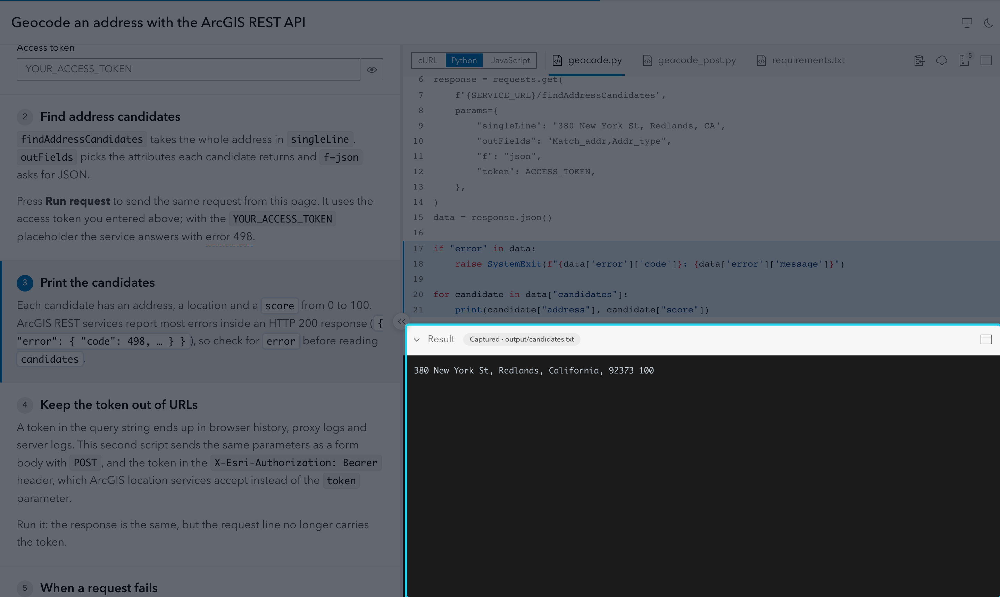
</picture>

Code that cannot run in the browser (scripts, native apps, [HTTP requests](#http-requests)) shows its result in the Result pane, which takes the Preview's place under the code. A tutorial without variants is web code when `code/` has `index.html`; with variants, each variant with `index.html` shows the Preview and every other variant shows the Result pane. The pane appears only when some step has `output=` or `request=`. Use `view="result"` to open it or `collapsed` to fold it, on a step or the intro.

```mdx title="tutorial/tutorial.mdx"
<Step id="request" region="request" output="geocode.json">

## Send the request

</Step>
```

- **Where outputs live**: `output="name"` looks up `output/<variant id>/name` first (a per-variant override), then `output/name`. It must resolve for every non-web variant the step covers.
- **File types**:
  - `.json`: a collapsible, colored tree (large ids keep their exact digits; a file that does not parse shows as text).
  - `.txt`, `.log`: terminal style. Prompt lines such as `$ cmd`, `> cmd`, `>>> cmd` or `PS C:\> cmd` are colored and ANSI color codes become colors.
  - `.png`, `.jpg`, `.jpeg`, `.gif`, `.webp`, `.svg`: an image.
  - Any other type is a build error.
- **Steps without a result** keep showing the result of the nearest earlier step that has one for the active variant, whether the reader scrolled, used step keys or opened a deep link. Before the first output the pane shows an empty state.
- **Published, not embedded**: outputs are published under `output/` and fetched when shown, so the page stays small and works offline. They are rendered as text or images, never as HTML. `output/` is not part of the ZIP.
- **Credentials**: outputs are committed and published. The build warns (without failing) when one looks like it holds a credential: `token=`, `"token":`, `apiKey` or `Authorization: Bearer` followed by a value that is not a var default. Replace real values with the var's default (the demo value in the code) before publishing.
- `output=` in web code is a build error: web code shows the Preview.

What readers can do in the pane (keyboard navigation of the JSON tree, collapsing, maximizing) is listed in [Features](features.md#result-pane).

## HTTP Requests

Requests live in `.http` files under `requests/` (VS Code REST Client / JetBrains HTTP Client syntax), so they stay runnable in those tools. They are not code tabs or variants: they are the source of the Result pane's [request runner](#request-runner) and are included in every ZIP as `requests/`, with form values applied. A `.http` file under `code/` is an ordinary code file and is never run.

```http title="tutorial/requests/geocode.http"
@serviceUrl = https://geocode-api.arcgis.com/arcgis/rest/services/World/GeocodeServer
@accessToken = YOUR_ACCESS_TOKEN

# @name geocode-get
GET {{serviceUrl}}/findAddressCandidates
  ?singleLine=380 New York St, Redlands
  &f=json
  &token={{accessToken}}

###

# @name geocode-post
POST {{serviceUrl}}/findAddressCandidates
Content-Type: application/x-www-form-urlencoded
X-Esri-Authorization: Bearer {{accessToken}}

singleLine=380 New York St, Redlands&f=json
```

```mdx title="tutorial/tutorial.mdx"
<Step id="geocode" region="geocode" request="geocode-get geocode-post">
```

Supported syntax:

- `###` separates requests.
- `# @name x` or `// @name x` names the next request (letters, digits, `_` and `-`). Unnamed requests are allowed but cannot be bound by `request=`.
- File variables `@x = value` anywhere in the file; `{{x}}` uses them within the same file.
- A request line `METHOD URL` (optional `HTTP/x` suffix) with `GET`, `POST`, `PUT`, `PATCH`, `DELETE`, `HEAD` or `OPTIONS`, optionally continued by lines starting with `?` or `&`; then headers (`Name: value`), a blank line and the body.
- Comments (`#`, `//`) outside the body.

Not supported (build errors):

- Request variables (`{{name.response…}}`) and system variables (`{{$guid}}`…).
- `< file` bodies, and pre-request or response handler scripts (`< `, `> `, `>> file`).
- `{{x}}` with no file variable `x`, and a request line without a supported method.
- A request name defined twice across `requests/`, or a `request=` name that does not exist or is listed twice.
- `request=` on a step whose variants are all web code (or in a tutorial with `code/index.html`).
- Binary files in `requests/`, and a `code/requests/` (or `code/<variant dir>/requests/`) folder that would overwrite `requests/` in the ZIP.

Other text files in `requests/` (for example a README) are zipped as is. `requests/errors.json` is the [error rule](#service-errors).

### Request runner

A [step](#step) with `request=` gets a **Run request** button in the Result pane. Nothing is sent until the reader presses it: activating a step never sends a request. [examples/rest-geocode](../examples/rest-geocode) is a complete example: a GET step (token in the query) and a POST step (token in a header), each running the request its code shows.

What to know as an author:

- **Run as**: when a step lists several requests, a picker labeled with each request's method (or its name when two share a method) chooses which one to send. The first is the default each time the step is shown. Offer an alternative only when the step's code shows it too: readers expect Run to send what they read.
- **Values**: every `{{x}}` takes the reader's [`<VarField>`](#varfield) value, else the file variable's default; file variables may use other file variables. Values substituted in the query string (after `?`) are URL-encoded; in the path, headers and body they are inserted as is.
- **Secrets**: the request line above the result shows the method and URL; values of `secret` vars are masked unless the reader presses **Show secrets**, which is off on every page load. Headers and body are not shown.
- **Failures**: a request is aborted after 30 s. On a timeout or a network/CORS failure the pane says so and shows the step's captured `output` instead, so give request steps one. A request the browser cannot build (an invalid URL, a body on `GET`/`HEAD`) is reported and not sent.
- **CORS**: requests are sent with `fetch` from the reader's browser without cookies, so the service must allow cross-origin requests; browsers drop headers they forbid (such as `Host` or `Cookie`).
- **Service errors**: errors reported inside a successful response need an [error rule](#service-errors).

What readers see (status badge, Body and Headers tabs, **Keep response**, **Show captured**) is described in [Features](features.md#result-pane).

### Service errors

Some APIs report errors inside a successful response: ArcGIS REST, for example, answers HTTP 200 with `{ "error": { "code": 498, "message": "Invalid token." } }`. Declare how to recognize them in `requests/errors.json`:

```json title="tutorial/requests/errors.json"
{
  "object": "error",
  "code": "error.code",
  "message": "error.message",
  "help": {
    "498": { "text": "The token is expired, revoked or mistyped.", "link": "https://…/error-codes#498" }
  },
  "fallbackLink": "https://…/error-codes"
}
```

- `object`, `code` and `message` (required) are dot paths from the root of the response body. A JSON body where `object` is an object is a service error, whatever the HTTP status.
- `help` (optional) maps codes to a short `text` and a `link`; `fallbackLink` (optional) is shown for codes without help. Links must be `http(s)` URLs.
- The pane shows the failure prominently: a red badge (`Error 498 · HTTP 200`), a notice with the code, the message, the help text and its link, and the body below it.
- The build validates the file (valid JSON, required paths, help entries, URLs, unknown keys) and reports errors as `requests/errors.json:<line>`. It is not a request file and is zipped with `requests/`.

## Files Not Shown in Tabs

- Binary files (images, fonts, jars, archives, anything with a NUL byte) never get a tab. They are published under `preview/` and added to the ZIP byte for byte.
- With [`files`](#frontmatter) set, text files that match no pattern are also left out of the code panel and the page, and still go into the ZIP.
- Files not shown in tabs cannot contain [`@var`](#variables) markers, and a [`<Step file>`](#step) or [`<Intro file>`](#intro) must point at a file shown in a tab.
- `index.html` is always available to the Preview, whether or not it is shown in a tab.

### Files left out of the tutorial

Some files in `code/` are never published: they get no tab, are not under `preview/` and are not in the ZIP.

- **Paths starting with `.`**: any file or folder whose name starts with `.`, at any depth (`.env`, `.venv/`, `src/.cache/`). They often hold secrets or local settings. The build warns about each such folder that is left out, e.g. `code/.github/ is not published`.
- **Gitignored paths**: anything a `.gitignore` excludes, so files your scripts write when you run the tutorial locally (`state.json`, `output.csv`, `token.json`, `build/`) are never published. See [`.gitignore` rules](#gitignore-rules).
- **Generated folders**: `node_modules/`, `__pycache__/`, `.git/`, tool caches (`.pytest_cache/`, `.mypy_cache/`, `.ruff_cache/`, `.gradle/`, `.idea/`, `.next/`, `.nuxt/`, `.svelte-kit/`, `.astro/`, `.cache/`, `.parcel-cache/`, `.turbo/`) and any folder with a `pyvenv.cfg` (a Python virtual env, whatever its name). The build does not even read them, so running the tutorial's own setup in `code/` keeps builds fast.

To publish project files that start with `.`, such as a GitHub Actions workflow the tutorial explains, list them in [`include`](#code-and-preview):

```yaml title="tutorial/tutorial.mdx"
---
include: [".github/workflows/*.yml", ".gitignore"]
---
```

`include` also publishes gitignored paths, e.g. a sample data file that real projects ignore, or `.env.example` next to an ignored `.env`. The build then warns, once per pattern, that it publishes a gitignored file, so check that it holds no secrets or local state.

Included text files get tabs like any other file (unless [`files`](#frontmatter) leaves them out) and steps can point at them. Generated folders cannot be included. In `images/`, `embeds/`, `output/` and `requests/` the same rules apply, without `include` and without `.gitignore`.

#### `.gitignore` rules

A typical tutorial whose scripts read secrets from `.env` and save their state between runs:

```text title="tutorial/code/.gitignore"
.env
state.json
```

```yaml title="tutorial/tutorial.mdx"
---
include: [".env.example"]
---
```

The ZIP then has `.env.example` (readers copy it to `.env`) and none of `.env`, `state.json` or `.gitignore`.

- **Which files apply**: `code/.gitignore`, a `.gitignore` in any folder inside `code/`, and those in the folders above it up to the root of the git repository that holds the tutorial (outside a repository, only the tutorial folder's). This matches what git commits, so a local build publishes what CI builds. A `.gitignore` above `code/` that excludes the tutorial folder itself is skipped. `.git/info/exclude` and your global excludes file are not read: they are specific to one machine.
- **Syntax**: as in git: comments, `!` negation, `dir/`, anchored `/file` and `a/b` (relative to that `.gitignore`'s folder), `*` and `**`. The deepest `.gitignore` with a matching rule wins, and a file inside an ignored folder cannot be re-included. Matching is case-sensitive, like git on Linux.
- **Precedence**: generated folders are never published. Paths starting with `.` and gitignored paths are left out unless `include` matches them.
- A [`<Step file>`](#step) or a [`files`](#frontmatter) pattern that points only at gitignored files is a build error that names the `.gitignore`.

## Code Variants

Variants show the same tutorial in several programming languages, for example a REST call as cURL, Python and Node.js. The prose and the steps are shared; only the code changes. When the explanations themselves differ by language, write [sibling tutorials](#sibling-tutorials) instead.

### Folder structure

Each variant lives in its own folder under `code/`. With `variants`, every code file must belong to a variant folder.

```text
tutorial/
  tutorial.mdx
  code/
    python/
      request.py
      requirements.txt
    curl/
      request.sh
    node/
      index.mjs
      api.mjs
  images/
    nodejs.svg
```

```yaml title="tutorial/tutorial.mdx"
---
title: Call the items API
variants:
  - { id: python, label: Python, dir: python, entry: request.py, files: ["request.py", "requirements.txt"] }
  - { id: curl, label: cURL, dir: curl, entry: request.sh }
  - { id: node, label: Node.js, dir: node, entry: index.mjs, logo: nodejs.svg }
---
```

| Key | Values | Default | Description |
|---|---|---|---|
| `id` | lowercase letters, digits, `-` | required | Used in `?variant=` links and `only=`. |
| `label` | string | required | Shown in the language switcher. |
| `dir` | folder | required | Relative to `code/`. Folders must not overlap. |
| `entry` | file | required | File shown first, relative to `dir`. |
| `files` | list of paths/globs | all text files: those the intro and steps show first, in step order, then the rest by path | Like the top-level [`files`](#frontmatter), relative to `dir`. The top-level `files` cannot be combined with `variants`. |
| `logo` | image path or `https://` URL | none | Icon next to `label` in the language switcher, with the same rules as the tutorial [`logo`](#frontmatter) (a file in `images/` or an `https://` URL). While the variant is active, the page header shows it instead of the tutorial logo. In a series, it is also the logo of its tag and link on the [index card](#index-page) when that tag has no logo in `tagGroups`. |

### Steps across variants

[Region](#regions) ids are the contract between variants. Give the same region the same id in every variant, in whichever file it lives:

```mdx title="tutorial/tutorial.mdx"
<Step id="request" region="request">

## Send the request

</Step>
```

- Within a variant, a region id may appear in only one file, so `region` alone identifies the file.
- `file` is relative to the variant folder and must exist in every variant the step covers.
- Every step region must exist in every variant, unless the step sets `only`:

```mdx title="tutorial/tutorial.mdx"
<Step id="install" file="requirements.txt" only="python">

## Install dependencies

</Step>
```

`otherVariantSteps` decides what readers of other variants see for such a step:

- `notice` (default): the step stays in place and keeps its number; the code panel keeps its file, clears the focus and shows "This step applies to Python" with an action to switch.
- `hide`: the step disappears from the explanations; numbering and progress count only the steps of the active variant. A `#step` link to a hidden step switches to that step's variant.

### Reader experience

- The language switcher sits at the start of the code header: a segmented control for up to four variants whose file tabs fit next to it, a dropdown otherwise. This is automatic.
- Variant `logo`s appear next to their labels in the switcher (decorative: the label names the variant). The page header shows the active variant's logo, or the tutorial `logo` for a variant without one; the favicon stays the tutorial `logo` (the first variant logo when the tutorial has none).
- In a [series](#series-sites), each variant `label` is also a tag of its tutorial: a tutorial with Python and cURL variants shows up when readers filter by Python or cURL, without repeating them in `tags`.
- Switching keeps the current step and focuses the same region in the new variant's file. A text-only step keeps the file with the same path when the new variant has it, else shows the new variant's `entry`.
- The choice is remembered for the whole site and can be linked: `?variant=curl#request`. An unknown id is ignored.
- Form fields are shared: one [`@var`](#variables) name fills every variant, and all its occurrences need the same default literal.

### Preview and downloads

- A variant is web code when its folder has `index.html`. Only web variants show the Preview; other variants show the [Result pane](#result-pane) instead when the tutorial has captured outputs. `preview` in the frontmatter applies to the web variants, and a tutorial without any web variant needs no `index.html`.
- A web variant's Preview runs from its own page, `preview/<dir>/index.html`, with every file of the variant published next to it, so relative references such as `./main.js` or an OAuth callback page resolve inside the variant folder.
- The ZIP holds only the active variant: its folder becomes the root of the archive, named `<tutorial>-<variant id>.zip`, plus `requests/` when the tutorial has it. The ZIP badge and tooltip count those files.

## Series Sites

A repository can publish several tutorials as one site. Put each tutorial folder (the [structure above](#folder-structure)) under a series folder:

```text
tutorials/
  display-map/       # published at /display-map/
    tutorial.mdx
    code/
  geocode/           # published at /geocode/
    tutorial.mdx
    code/
  _drafts/           # ignored: starts with "_"
```

The CLI detects this structure on its own: with no `tutorial/tutorial.mdx` and no root `tutorial.mdx`, but at least one `tutorials/<name>/tutorial.mdx`, `interactive-code-scroll dev` serves the whole series. For another folder name, pass `--tutorials <dir>`; `--tutorial tutorials/<name>` still serves one tutorial on its own. To publish the series on GitHub Pages, use the workflow in the [Deployment Guide](deployment.md#github-pages): the same file works for one tutorial or a series, and every tutorial URL keeps the Pages base path (`/<repo>/display-map/`). In your own `astro.config.mjs`:

```js title="astro.config.mjs"
interactiveCodeScroll({ tutorials: "tutorials" })
```

- The folder name is the tutorial's URL, so it must use lowercase letters, digits and `-` (build error otherwise).
- Folders starting with `_` or `.` are ignored; other folders without `tutorial.mdx` are skipped with a warning.
- Each tutorial's Preview, published code and captured outputs live under its own URL. Its header gets an "All tutorials" link back to the index.
- `tutorial` and `tutorials` cannot be combined.
- Persisted [`<VarField>`](#varfield) values are shared by every tutorial on the site (enter a key once); use `persist="tutorial"` for a value that belongs to one tutorial. A Preview never shows another tutorial's code.

### Index page

`/` lists every tutorial as a card: title, `description`, `level`, `duration`, `updated`, technologies and `tags` from each tutorial's [frontmatter](#frontmatter) (plus its [variant](#code-variants) labels as tags), ordered by `order` (lower first; tutorials without it follow, by title). Card tags are plain labels: the whole card is one link.

<picture>
  <source media="(prefers-color-scheme: dark)" srcset="../site/public/screenshots/series-index-dark.png">
  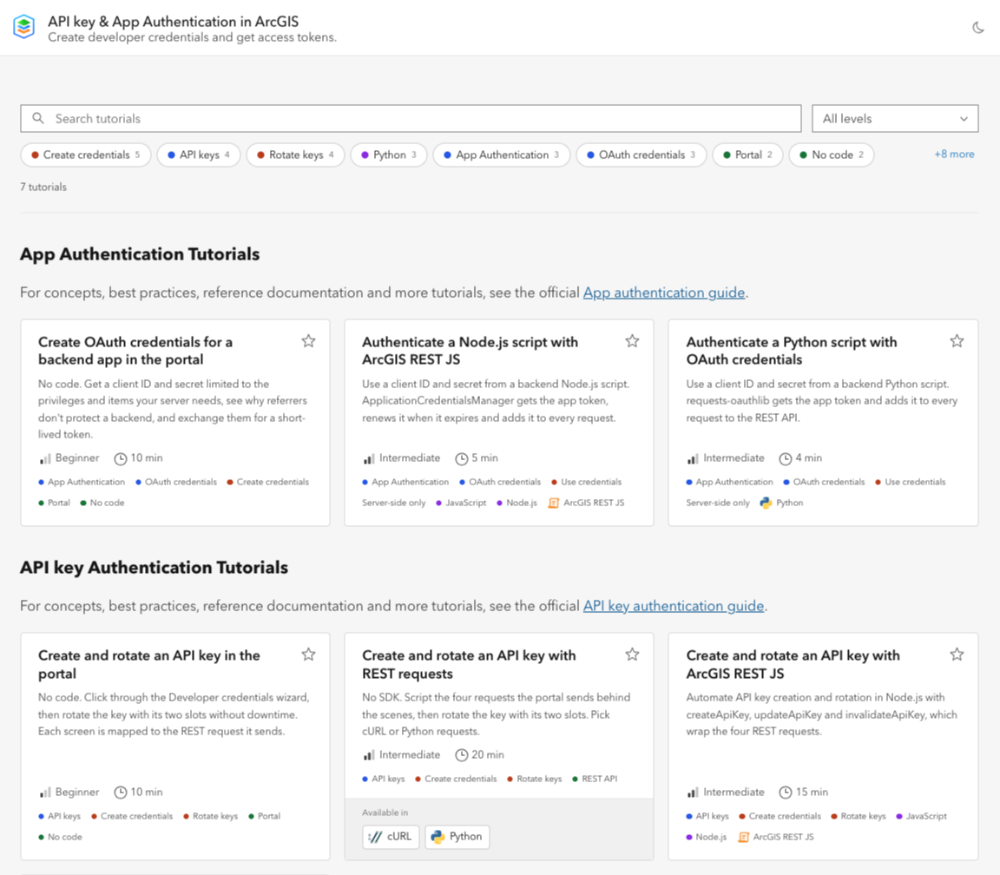
</picture>

Above the cards, a search bar filters every list on the page as the reader types:

- **Text**: matches titles, descriptions, tags and levels, ignoring case and accents; every word must match. Matches are highlighted in titles and descriptions (from two characters on).
- **Tag suggestions**: typing offers matching tags; picking one (arrow keys and Enter, or a click) selects it.
- **Tags**: the most used tags that fit on one line, each with the number of tutorials it would show added to the current search, so no tag leads to an empty result (tags with none leave the line and are disabled in the panel; selected tags always stay); "+N more" lists every tag, grouped by family when you set [`tagGroups`](#tag-families).
- **Level**: a dropdown, when any tutorial has a `level`.

The count says how many tutorials match ("2 of 9 tutorials"), "Clear filters" resets everything, `/` focuses the search, and the URL keeps the state (`?q=token&tags=Python&level=Beginner`), so a filtered view can be shared. Without JavaScript the bar is hidden and every card shows.

A tutorial with two or more [variants](#code-variants) has an **Available in** band at the bottom of its card, with a link to each variant (`?variant=<id>`), so readers jump straight to their language; when they filter by a variant's tag (Python), the card's title opens that variant too. At most four links show (past that, three and "+N"). A tag with a logo shows it, with its name, instead of the family dot. The logo comes from [`tagGroups`](#tag-families), else from the [variant](#code-variants) with that label. Give logos to what readers write code with (languages, SDKs, libraries, CLIs), not to platforms or products a tutorial applies to (ArcGIS Online, ArcGIS Enterprise…): those stay plain tags. Card titles have no logo; the tutorial `logo` is for its page header and favicon.

To customize the index, add `tutorials/index.mdx`:

```mdx title="tutorials/index.mdx"
---
title: ArcGIS tutorials
description: Build apps with ArcGIS, from REST to native SDKs.
logo: logo.svg
theme: auto
tagGroups:
  Language:
    - { name: JavaScript, logo: javascript.svg }
    - { name: Python, logo: python.svg }
  Auth: [OAuth, API keys]
---

Start with the REST tutorials if you are new to location services.

<TutorialFilter />

<TutorialFavorites />

## Web apps

<TutorialList tags="JavaScript, Web" />

## Scripts

<TutorialList tags="Python" level="Beginner" />
```

| Field | Values | Default | Description |
|---|---|---|---|
| `title` | string | `Tutorials` | Header heading and page title. |
| `description` | string | none | Shown under the title in the header and as the page's meta description (clipped on narrow screens). |
| `logo` | image path or `https://` URL | none | Relative to `tutorials/images/` (that folder is never a tutorial), or an absolute `https://` URL. |
| `theme` | `auto`, `light`, `dark` | `auto` | Author default. Viewer changes are remembered site-wide. |
| `tagGroups` | family name → list of tags (or `{ name, logo }`) | none | [Tag families](#tag-families), in display order, and tag logos. |
| `feedbackUrl` | `https://` or `mailto:` URL | none | Default [feedback link](#outro) of every tutorial; a tutorial's own `feedbackUrl` replaces it. `{slug}` and `{title}` are the tutorial's. |
| `ask` | list of `author`, `chatgpt`, `claude`, `{ label, url }`, or `false` | `[author, chatgpt, claude]` | Default [selection toolbar](#asking-about-a-selection) actions of every tutorial; a tutorial's own `ask` replaces it. |
| `presentationUrl` | `http://` or `https://` URL | none | Default QR code URL of every tutorial's [closing slide](presenting.md#during-the-talk), e.g. `https://owner.github.io/tutorials/{slug}/`; a tutorial's own `presentationUrl` replaces it. |
| `outline` | boolean | `true` | Default [step outline](#step-outline) next to an intro without media; a tutorial's own `outline` replaces it. |

The body is free MDX prose with three components; anything else is a build error.

| Component | Props | Description |
|---|---|---|
| `<TutorialList>` | `tags="A, B"`, `level="Beginner"` | A section of cards. `tags` (comma-separated, since a tag may contain spaces) keeps tutorials with any of those tags; `level` keeps that exact level; both combine. Without props it lists every tutorial. A tag or level no tutorial uses fails the build. |
| `<TutorialFilter>` | none | The search bar, where you place it. It filters every list on the page and counts tutorials once even when they appear in several sections. At most one per page; leave it out to show no search. |
| `<TutorialFavorites>` | none | Lets readers mark tutorials as favorites: a star on every card of the page and, where you place it, a "Favorites" section with the marked tutorials in series order (hidden while there are none). Favorites are stored in the reader's browser, per site; the search bar filters this section too. At most one per page. Worth it with many tutorials; leave it out of small series. Without JavaScript there are no stars and no section. |

Without `index.mdx`, the index is the search bar plus one list of every tutorial.

#### Tag families

With many tags, group them with `tagGroups`: a family name for each list of tags, in the order the "+N more" panel shows them. Tags without a family go under "Other".

- Each family gets a color: a dot next to its tags on the chips and cards. Tags without a family have no dot.
- Tags in the same family match **any** of them; different families must **all** match. With `Language: [JavaScript, Python]` and `Auth: [OAuth]`, selecting JavaScript, Python and OAuth shows OAuth tutorials in JavaScript or Python. Without `tagGroups`, any selected tag is enough.
- A tag can be `{ name, logo }` instead of a name: its logo on every [card](#index-page) (tags and variant links), defined once for the whole site. `logo` follows the index `logo` rules (a file in `tutorials/images/` or an `https://` URL). It wins over a variant logo, which still shows in that tutorial's language switcher.
- Build errors: a tag in two families, an empty family, a tag no tutorial has (variant labels count), and a tag logo missing from `tutorials/images/`.

### Custom index page

For full control, replace the index with your own Astro page. Keep it outside `src/pages/` (Astro would also publish it as a route of its own). Pass it to the CLI:

```sh
interactive-code-scroll dev --index src/series-home.astro
```

or set it in your own `astro.config.mjs`:

```js title="astro.config.mjs"
interactiveCodeScroll({ tutorials: "tutorials", index: "src/series-home.astro" })
```

```astro title="src/series-home.astro"
---
import { tutorials, TutorialFavorites, TutorialFilter, TutorialList } from "interactive-code-scroll/series";
---
<html lang="en">
  <head>
    <meta charset="utf-8" />
    <meta name="viewport" content="width=device-width, initial-scale=1" />
    <title>My tutorials</title>
  </head>
  <body>
    <h1>{tutorials.length} tutorials</h1>
    <ul>
      {tutorials.map((t) => <li><a href={t.href}>{t.title}</a> {t.level}</li>)}
    </ul>
    <TutorialFilter tagGroups={{ Language: ["JavaScript", "Python"] }} />
    <TutorialFavorites />
    <TutorialList tags="Python" />
  </body>
</html>
```

- `tutorials` lists every tutorial in index order: `slug`, `href` (includes Astro's `base`), `title`, `tags`, and `description`, `level`, `duration`, `updated` (`YYYY-MM-DD`), `order` when set; `logo` (URL of the tutorial logo), `tagLogos` (tag → logo URL) and `variants` (`{ id, label, href, logo }`, links that open each variant, with two or more) when any. `tags` include the variant labels.
- `<TutorialList>`, `<TutorialFilter>` and `<TutorialFavorites>` work as in `index.mdx` and bring their own styles and filter script. `<TutorialFilter tagGroups={…}>` takes the [tag families](#tag-families) that `index.mdx` sets in its frontmatter, without logos: tag logos on a custom page come from variant logos. The page owns everything else (layout, header, theme). Include `<meta charset="utf-8" />`: Astro does not add it, and without it non-ASCII text (such as `—` or accents) renders garbled.
- `index` must be an `.astro` file, needs `tutorials`, and cannot be combined with `tutorials/index.mdx` (build error: the file would be ignored).

### Sibling tutorials

When the explanations differ by language (for example the JavaScript SDK and the Python API), write one tutorial per language and link them with the same `family`. Use [code variants](#code-variants) instead when the steps and prose are shared.

```yaml
# tutorials/display-map-js/tutorial.mdx
family: display-map
familyLabel: JavaScript
```

```yaml
# tutorials/display-map-python/tutorial.mdx
family: display-map
familyLabel: Python
```

- The header shows a "<familyLabel> ▾" menu after the title (named "Tutorial for: <familyLabel>" for screen readers; each entry shows the sibling's `logo`, else its first variant logo), with links to the family's tutorials by `order`, then `familyLabel`.
- Choosing a sibling opens it on the step with the same id when it exists (give matching steps the same `id`), else at its top. The reader's code variant carries over when the sibling has a variant with that id.
- Keep siblings and variants apart: a sibling's `familyLabel` should not repeat a language that is already a code variant of another sibling (for example a "REST API" tutorial with a Python variant next to a "Python" sibling), or readers see two "Python" choices that do different things.
- `family` and `familyLabel` go together, and each label must be unique within its family (build errors). A family with one tutorial, or `family` outside a series site, only warns.
- The index keeps one card per tutorial.

## Validation

The build checks every reference before it writes the site: a wrong file, region, variable, image, output, request or frontmatter value fails it. Every error names the file, line and column, and frontmatter errors point at the offending key. In dev mode, validation re-runs whenever `tutorial.mdx` or a file under `code/`, `images/`, `requests/` or `output/` changes, and the error appears in the browser overlay at the first failing line.

### Common build errors

Errors start with the location, for example `tutorial/tutorial.mdx:12:1 <Step> …` or `main.js:4: …`. The message is the part after it:

| Message | Fix |
|---|---|
| `<Step> file "x" not found in code/` | `file` is relative to `code/` (to the variant folder with variants). Check the path and extension. |
| `<Step> region "x" not found in code/main.js` | Add `#region x` / `#endregion x` to that file, or fix the id. |
| `<Step> region "x" requires a "file"` | Without variants, a region needs `file`. A [JSON region](#json-regions) always needs `file`. |
| `<Step> region "/x" not found in code/package.json` | Fix the [JSON Pointer](#json-regions): keys are case-sensitive, nested keys are separated by `/`. |
| `<Step> region "/x" is a JSON Pointer, but code/main.js is not a .json file; …` | A `region` starting with `/` only works in `.json` files; use `#region` comments elsewhere. |
| `<Step> region "/a../b": code/x.json: "/a" and "/b" must be in the same object or array` | A [range](#json-regions) joins sibling members only; point both ends at the same level. |
| `<Step> region "/a../b": code/x.json: "/b" must come after "/a"` | Write the range in file order. |
| `<Step> region "x" not found in variant "y" (code/y/); add it or set "only"` | Every variant needs the region, unless the step sets [`only`](#steps-across-variants). |
| `<Step> file "x" is not shown in tabs; add it to frontmatter "files"` | The file is left out by [`files`](#files-not-shown-in-tabs). |
| `<Step> "images" must be a static array of strings, e.g. images={["a.png"]}` | Write the array in place, in braces: `images={["a.png"]}`. |
| `<Step> image "x" not found in images/` | Paths are relative to `images/`. |
| `<Step> embed "x" not found in embeds/ (a folder needs an index.html)` | Paths are relative to `embeds/`; a folder needs an `index.html`. |
| `<Step> embed "x" must be an https:// URL or a path in embeds/` | Use `https://` (not `http://`), or a relative path without `..` or a leading `/`. |
| `<Step> "embed" and "images" cannot be combined; use one step for each` | Split the step in two. |
| `<Intro> "embed" and "images" cannot be combined; use one of them` | Keep one; move the other to the first step. |
| `<Intro> "file" and "images" cannot be combined; use one of them` | The intro shows either a file or media; move the other to the first step. |
| `<Step> output "x" not found in output/` | Add the file to `output/` (or `output/<variant id>/`). |
| `<Step> output "x" has no effect: code/index.html makes the tutorial web code, which shows the Preview` | Web code has no Result pane: remove `output` or `index.html`. |
| `<Step> request "x" not found in requests/ (# @name x)` | Name the request with `# @name x` in a `.http` file under `requests/`. |
| `<Step> maximize="panel" has no pane to maximize: …` | Enable the iframe [Preview](#preview) or give some step a result. |
| `<Step> duplicate id "x"` | Step ids are unique per tutorial. |
| `<Intro> "x" is not available on <Intro> (only view, collapsed, panelHeight, maximize, file, images, embed, outline)` | Move `region`, `output` or `request` to the first step. |
| `<Step> "outline" takes no value: write <Step outline>` | Write `outline` alone, without `="…"` or `{…}`. |
| `<Step> "outline" and "file" cannot be combined; use one of them` | The outline replaces the code: drop `file`, `region`, `images` or `embed`, or move the outline to its own step. |
| `"outline" must be a boolean` | Frontmatter `outline: false` (or `true`), without quotes. |
| `<Outro> must come after the last <Step>` | Move it to the end of `tutorial.mdx`. |
| `tutorials/x: "next" tutorial "y" is not in the series` | Use the folder name of another tutorial, or `next: false`. |
| `<VarField> no "@var x" found in code/` | Add `// @var x` next to the literal in the code, or fix the name. |
| `@var "x" must have the same default in every file: …` | Use the same literal in every file that marks `x`. |
| `code/x: @var "y" is in a file not shown in tabs; …` | Show the file in tabs or remove the marker. |
| `@var x has no string, number or boolean literal on its line` | Put the marker on the line of a plain string, number or boolean literal. |
| `<VarField> json …: pointer "/a" not found` | Fix the pointer; it starts with `/` and walks keys and array indexes. |
| `invalid JSON: comments are not allowed …` | Remove the `@var` comment from the JSON file and use `<VarField json="file.json#/pointer">`. |
| `<VarField> the code default "x" is not one of the options` | Add the default to `options`, or change the literal in the code. |
| `<VarField> options file "x.json" not found in field-options/` | Create the file in `tutorial/field-options/` or fix the name. |
| `@var "x" must have the same type in every file: …` | Use the same kind of literal (string, number or boolean) in every file that marks `x`. |
| `#region "x" is empty` · `unclosed #region "x"` · `#endregion "a" closes #region "b"` | Fix the [region markers](#regions) in that file. |
| `frontmatter include "x" matches no path in code/ starting with "." or gitignored …` | Fix the glob (relative to `code/`). Other paths are published anyway, and generated folders such as `node_modules/` cannot be included. See [Files left out of the tutorial](#files-left-out-of-the-tutorial). |
| `<Step> file "x" is gitignored (by code/.gitignore) and not published …` · `frontmatter files "x" matches only gitignored files …` | Point the step at a published file, or add the file to frontmatter `include` if readers should get it. See [`.gitignore` rules](#gitignore-rules). |
| `frontmatter logo "x" not found in images/ (or use an https:// URL)` | Put the logo in `images/` or use an `https://` URL. |
| `frontmatter variants[n].logo "x" not found in images/ (or use an https:// URL)` | Same for a [variant](#code-variants) logo. |
| `frontmatter tagGroups tag "x": logo "y" not found in images/ (or use an https:// URL)` | Put the [tag logo](#tag-families) in `tutorials/images/` or use an `https://` URL. |
| `code/x: file is outside every variant folder; move it into one of …` | With variants, every code file belongs to a variant folder. |

The build also warns, without failing, about each `code/` folder starting with `.` that is not published (unless `.gitignore` excludes all of it): `code/.github/ is not published (paths starting with "." are skipped); add ".github/**" to frontmatter "include" to publish it`; and about each `include` pattern that publishes gitignored files: `frontmatter include "sample/**" publishes code/sample/data.json, which code/.gitignore excludes; make sure it holds no secrets or local state`.
