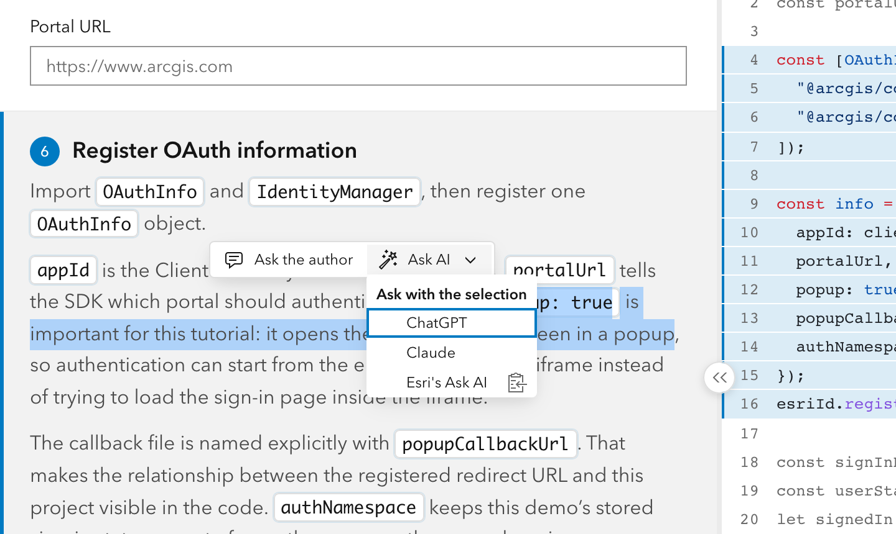
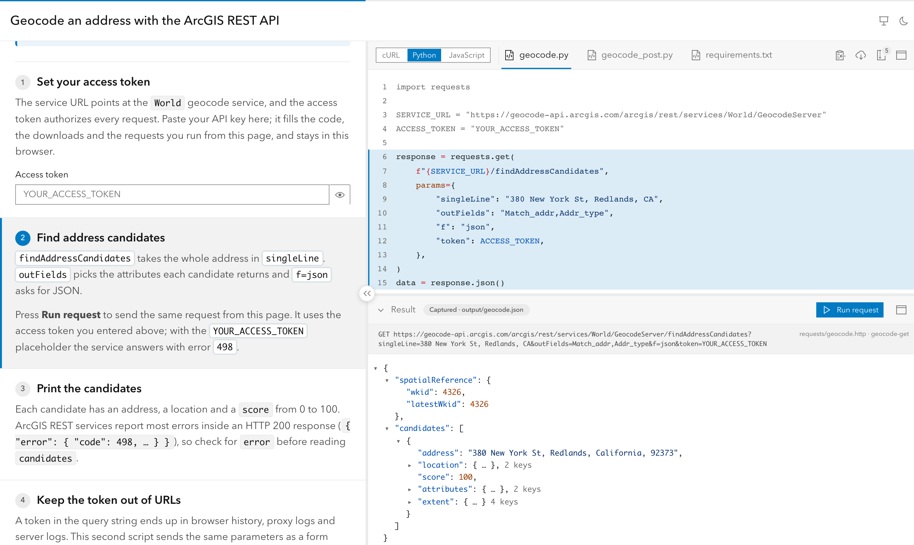
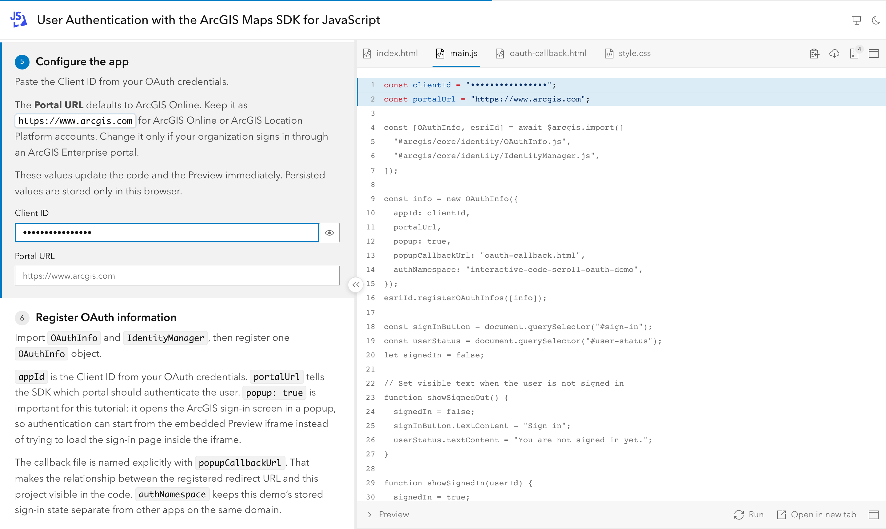
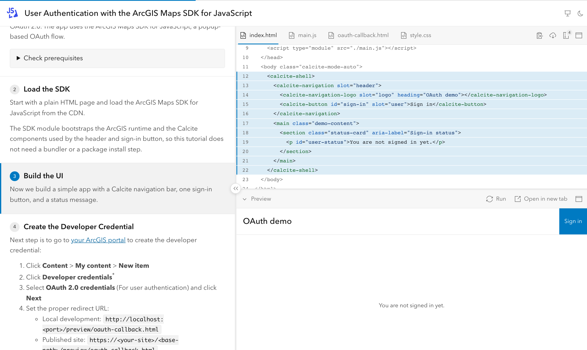
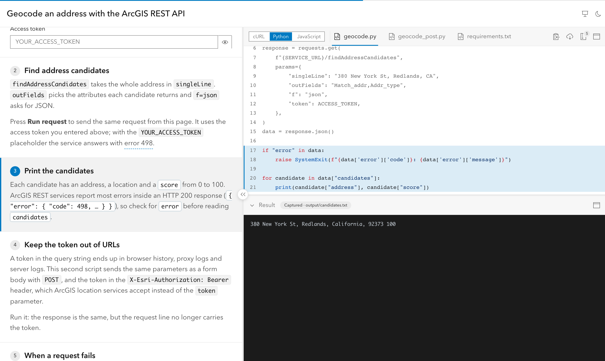
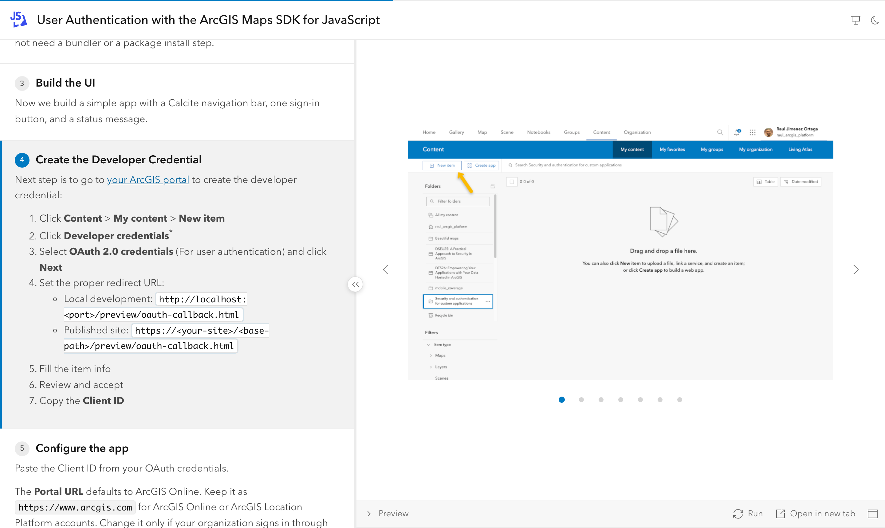
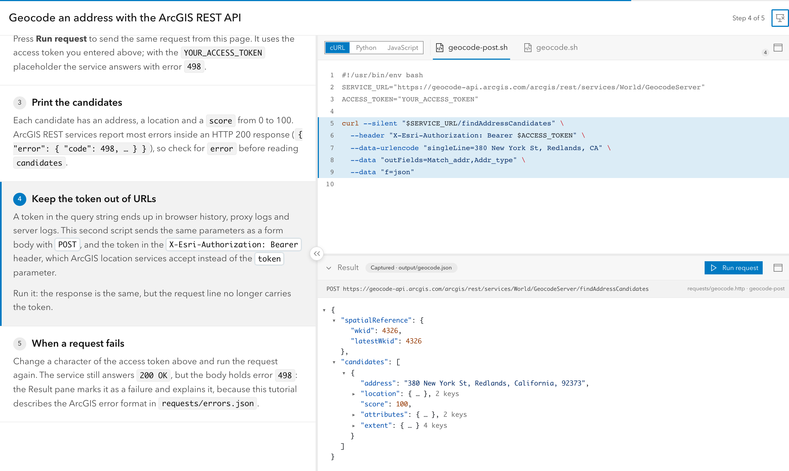

# Features

What InteractiveCodeScroll can do, in one page. Each section links to the reference that shows how to use it. For the file formats and every option, see [Authoring Reference](authoring.md); for commands, see [CLI Reference](cli.md).

A tutorial is a folder with `tutorial.mdx` (the explanations), `code/` (the final, runnable project) and `images/`. The build turns it into a static site: explanations on the left, code on the right, kept in sync as the reader moves through the steps.

## Reading a tutorial

<picture>
  <source media="(prefers-color-scheme: dark)" srcset="../site/public/screenshots/reading-oauth-dark.png">
  
</picture>

- **Side-by-side layout**: explanations on the left, code on the right. Both splitters (explanations/code, code/Preview) can be dragged, and their sizes are remembered. A handle that appears on the splitter hides the explanations; a thin rail at the left edge brings them back.
- **Readable lists**: ordered, unordered and nested lists share consistent item spacing, including items with multiple paragraphs, without an extra gap after sublists.
- **Phones**: in portrait the code sits on top and the explanations scroll below it, with Back / Next at the bottom; tapping the title shows it in full or opens the sibling tutorial menu. On phones the Preview and Result pane open full screen from their header, and copy/download actions are hidden.
- **Tutorial subtitles**: optional `subtitle` frontmatter adds a smaller, muted line beneath the navigation title, with an ellipsis for long text. See [Frontmatter](authoring.md#frontmatter).
- **Steps drive the code panel**: when a step becomes active, it can switch file, focus a region (the rest of the file turns gray and the region scrolls into view) or show images instead of code. A text-only step keeps the current file and clears the focus. A file switch stands out: the step names the new file in a chip, and its tab flashes when the step becomes active.
- **Several ways to move**: scrolling (the step crossing the middle of the panel becomes active), clicking a step, the Back / Next buttons under the explanations (hidden in presentation mode), arrow keys and PageUp/PageDown (presentation clickers work too, even while the focus is in a field or the Result pane).
- **Listen to a tutorial**: choose **Step by step** to pause and practice, or **Continuous** to listen through the tutorial. Both modes have equal prominence on first use; the visible mode selector keeps switching easy. The distinct audio row shows playback state, pause/resume, Continue, speed and settings, with independent options for hint explanations and collapsed sections. Hints introduce their label for audio context; click prose or use **Read from selection** to seek to a sentence. Browser voices read the introduction, steps and closing prose with progressive highlighting. Preferences are remembered without autoplay. Presentation uses one audio button beside Keyboard shortcuts to show/hide the full controls; Hide keeps playback going and Close stops it. Works in reading/presentation modes and with explanations hidden; Alt+Shift+L starts, pauses or resumes. See [Listen to a tutorial](authoring.md#listen-to-a-tutorial).
- **Step index**: the position between Back and Next ("5 / 10") opens the list of steps, with a check on the ones already seen and the current one marked; a click jumps to a step, and step keys keep moving while it is open. A bottom sheet on phones. See [Step index](authoring.md#step-index).
- **Step outline**: the same list as an agenda in the code area, next to an intro without media and on any step with `outline` (a recap halfway through). See [Step outline](authoring.md#step-outline).
- **A closing panel**: at the last step "Next" becomes "Finish", which opens a short "You've completed …" panel with the next tutorial of the series, the code download, the Preview, the index and an optional feedback link, plus the author's own closing text (`<Outro>`). In presentation mode it is a full-screen closing slide with a large QR code of the tutorial's URL.
- **Numbered steps, progress bar and deep links**: every step heading carries its number; a thin bar under the header shows the steps seen, the current one and those left; `#step-id` links open the tutorial at that step.
- **Optional introduction**: content before the first step that is not numbered and does not focus any code. It can start with the Preview or Result pane collapsed or maximized (`<Intro collapsed>`), open on a given file (`<Intro file="README.md">`), and show images or an embedded page instead of code (`<Intro images={["overview.png"]}>`); a tutorial with nothing else to show opens on the first step's media.
- **What to expect, before starting**: a small line above the explanations shows the last update, the duration and the level (with the same difficulty bars as the series cards), when the frontmatter sets them; hidden in presentation mode.
- **Light and dark**: follows the OS by default; the author can set a default and the reader's toggle wins. The code panel and the Preview follow the page.
- **Readable at high zoom**, with line numbers and optional wrapping of long lines. The Result pane header turns long labels into icons instead of clipping them, and a short pane scrolls as a whole.

See [Components](authoring.md#components).

## Asking about a selection

<picture>
  <source media="(prefers-color-scheme: dark)" srcset="../site/public/screenshots/ask-oauth-dark.png">
  
</picture>

- **A toolbar on the selection**: selecting a sentence in the explanations or a few lines of code shows a small toolbar over it, once the selection ends. It stays out of the way: not for a single word, not on touch screens or in presentation mode, and Esc hides it.
- **Ask the author**: opens your `feedbackUrl` (for example a new GitHub issue) with the step, the selected text and a link back to it, so a human answers.
- **Ask AI**: opens ChatGPT, Claude or your own assistant with a ready prompt about the selection, linking the whole tutorial as Markdown; the prompt is also copied, for assistants that cannot take it in the link.
- **A link back to the exact spot**: the link opens the step and highlights the selected text. Code selections carry the file and line numbers, with secret values masked.
- **Configurable**: on by default; `ask` picks the actions per tutorial or for a whole series, or turns the toolbar off. See [Asking about a selection](authoring.md#asking-about-a-selection).

## Code

<picture>
  <source media="(prefers-color-scheme: dark)" srcset="../site/public/screenshots/hero-rest-python-dark.png">
  
</picture>

- **Final code, highlighted**: every file is shown in its final version; steps only focus parts of it. Highlighting happens at build time for JavaScript/TypeScript, HTML, CSS, JSON, Markdown, shell, YAML, Python, Kotlin, Swift, C#, Java, C++, Dart, SQL, `.http` and more, and can be overridden per extension.
- **Regions and variables as comments**: `#region id` / `#endregion` marks what a step focuses; `@var name` marks a literal a form field can change. The source stays valid and runnable; markers never reach the reader or the downloads. JSON files, which have no comments, are targeted by JSON Pointer instead: `<Step region="/dependencies">` (or a range of members, `/name../scripts`) and `<VarField json="config.json#/days">`.
- **Large projects**: the `files` list picks which files get tabs. Everything else, including binary files such as a Gradle wrapper jar, still goes into the ZIP. Local and generated files are left out (`.env`, `.venv/`, `node_modules/`, `__pycache__/`, and anything a `.gitignore` excludes, such as a `state.json` your scripts write), so the tutorial's own setup can run in `code/`; `include` publishes project files such as `.github/workflows/` or `.env.example` ([Files left out of the tutorial](authoring.md#files-left-out-of-the-tutorial)).
- **Code variants**: the same steps in several languages (for example cURL, Python and Node.js) with a language switcher, deep links such as `?variant=curl`, steps that apply to only some languages, a Preview for web variants, a ZIP per variant and optional per-variant logos in the switcher. See [Code Variants](authoring.md#code-variants).

See [Code Markers](authoring.md#code-markers) and [Files Not Shown in Tabs](authoring.md#files-not-shown-in-tabs).

## Forms that edit the code

<picture>
  <source media="(prefers-color-scheme: dark)" srcset="../site/public/screenshots/forms-oauth-dark.png">
  
</picture>

- `<VarField>` inputs in the explanations update the code as the reader types (client ID, API key, portal URL…). The literal in the code is the default.
- **Field types**: text, multi-line text, number, switch, dropdown, radio buttons (stacked or in a row) and a searchable combobox, with choices inline or from a JSON file. Consecutive fields share a row when the panel is wide enough.
- **Secret fields** are masked in the form and in the code, with a reveal toggle.
- **Persisted fields** are remembered per site, so a credential typed once fills every tutorial on the same site; `persist="tutorial"` keeps a value to one tutorial.
- Values are escaped for each language and quote style, and are included in Preview and downloads.

See [`<VarField>`](authoring.md#varfield) and [Variables](authoring.md#variables).

## Preview

<picture>
  <source media="(prefers-color-scheme: dark)" srcset="../site/public/screenshots/oauth-preview-dark.png">
  
</picture>

- Runs the tutorial's web code (`code/index.html`) from a real page of the site: embedded, in a new tab, or both.
- Refreshes after form changes, or with Run. A step can expand or collapse it.
- OAuth sign-in works from the embedded Preview through a popup, and in the new tab through a normal redirect.
- Form values reach every file the app loads: imported modules (a shared `config.js`), fetched files and other pages such as an OAuth callback.

By default, the embedded pane shows the app under a **Preview** header. Set `console: true` to add **Preview** and **Console** tabs under an **Output** header. See [Preview](authoring.md#preview).

## Live browser console

**Available since 0.2.0-beta.10.** Explain the response your code actually received, without leaving the tutorial or adding a debug panel to the sample app.

<picture>
  <source media="(prefers-color-scheme: dark)" srcset="../site/public/screenshots/console-web-dark.png">
  
</picture>

The screenshot uses demo data produced by an interaction in the running Preview. Console captures the actual arguments passed to `console.log`, `info`, `warn` and `error` at runtime.

- **Optional per tutorial**: set frontmatter `console: true` to add Console; leave it out for a plain Preview without tabs. Requires `preview: iframe` or `both`.
- **From interaction to explanation**: use Preview to run the app, then select Console to explore its output. Switching tabs preserves the app and its messages.
- **Objects you can explore**: collapsible trees, compact property previews, type colors, message levels and source file/line when the browser provides them.
- **Size alongside the code**: `<Step panelHeight={30}>` and `<Intro panelHeight={30}>` reserve 30% of the right column for Preview, Console or Result. Readers can adjust it; phones keep the maximized view. Opening or resizing reveals the active code region when it fits. See [pane controls](authoring.md#panel-and-console).
- **Directed by your steps**: `view="console"` opens Console alongside the highlighted code; `view="preview"` returns to the app. `maximize="panel"` gives the selected view the window.
- **Live messages, stable objects**: messages arrive as the app runs; each object preserves its values at log time. Selecting a step does not execute code or make a request. Nothing needs to be exported to a static result file.
- **No debug UI or extra service**: keep ordinary `console.log` calls in the sample. The framework captures them in dev and the built static site; the browser's DevTools still receives the original messages.

```mdx
---
title: Explore an API response
preview: iframe
console: true
---

<Step id="inspect-response" file="main.js" region="response" view="console">
  ## Explore the response
  Run the example in Preview, then expand the logged object here.
</Step>
```

For configuration, a complete step sequence, snapshot behavior and capture limits, see [Panel and Console](authoring.md#panel-and-console). Existing authors should also read the [panel API migration](upgrade.md#panel-api-migration-020-beta10).

## Result pane

<picture>
  <source media="(prefers-color-scheme: dark)" srcset="../site/public/screenshots/result-rest-text-dark.png">
  
</picture>

- Takes the Preview's place for code that cannot run in the browser (scripts, native apps): a step with `output="geocode.json"` shows a captured result from `output/`, with per-language overrides in `output/<variant>/`.
- JSON is shown as a collapsible, colored tree (keyboard navigable, long lists paged by 100), text in terminal style (colored prompt lines and ANSI colors), images as images. Steps without an output keep the last result. Works offline.
- The build warns when a captured output looks like it contains a real credential.
- HTTP requests live in `.http` files under `requests/` (VS Code REST Client / JetBrains syntax): steps bind them with `request="geocode-get geocode-post"`, the build validates the supported syntax and names, and every ZIP includes `requests/` with form values applied.
- A Run request button sends the step's request live from the browser with the reader's form values (a "Run as" picker when the step offers several, e.g. GET and POST), shows the status, time and response body, masks secrets in the request line (with a "Show secrets" toggle), gives up after 30 s and falls back to the captured output when the network or CORS fails. Readers can keep a live response for the session; Show captured returns to the captured one.
- Live responses have Body and Headers tabs: JSON as a tree, images as images, long text cut at 200 KB with "Show all"; Headers lists what the server exposes through CORS.
- Service errors inside responses (e.g. ArcGIS REST answering HTTP 200 with an `error` object) are shown as failures, with the code, message and a help link from `requests/errors.json`.
- Example: [examples/rest-geocode](../examples/rest-geocode) geocodes an address with the ArcGIS REST API in cURL, Python and JavaScript, with a GET step and a POST step (token in a header), captured outputs and the ArcGIS error rule.

See [Result Pane](authoring.md#result-pane).

## Images

<picture>
  <source media="(prefers-color-scheme: dark)" srcset="../site/public/screenshots/oauth-images-dark.png">
  
</picture>

- A step can show one image or a carousel instead of code. Step keys page through the images first; clicking an image opens a full-screen viewer.

See [`<Step>`](authoring.md#step).

## Downloads

- Copy the current file, download it, or download the whole project as a ZIP with the reader's form values applied, ready to run locally. The ZIP button shows how many files it contains.

## Markdown for AI assistants

- Each tutorial publishes a plain Markdown version, `tutorial.md` (one per code variant), with the prose, each step's code with defaults applied, and the final code; the site lists them all in `llms.txt`. Readers link or paste it in any AI assistant. On by default; see [Markdown for LLMs](authoring.md#markdown-for-llms).

## Presenting

<picture>
  <source media="(prefers-color-scheme: dark)" srcset="../site/public/screenshots/present-rest-curl-dark.png">
  
</picture>

- **Presentation mode** (the header icon or Alt+P) fills the screen with a compact toolbar; the explanations can be hidden too. Step keys and clickers keep working, including while the focus is inside the Preview, a form field or the Result pane.
- **Step index on screen**: the header's "Step 5 of 10" opens a large, centered list of the steps; the clicker keeps moving the real step while it is open.
- **Single-key shortcuts while presenting**: `O` (or a clicker's "blank screen" key, `b` / `.`) opens and closes the step index, `E` shows and hides the explanations. `1` collapses/restores the lower panel, `2` / `3` / `4` set it to 35% / 50% / 75% with a short animation (none with reduced motion), `5` maximizes/restores it, `0` maximizes/restores code or media, and `H` toggles region emphasis until the next step. Sizes preserve the selected Preview / Console / Result view. A lone Alt press lists all active keys, including narration; "All shortcuts" or the header's "Keyboard shortcuts" action opens persistent grouped help. See [During the talk](presenting.md#during-the-talk).
- **Esc one level at a time**: a dialog, the step index, a maximized pane, then presentation mode, also in browser full screen in Chrome and Edge.
- **Maximize a pane**: the code, the Preview or the Result pane fills the window from its header icon or from a step or the intro (`maximize=`); the icon or Esc restores the layout. Step keys keep working.
- **Serve locally** with the CLI when the venue's network is unreliable.

See [Presenting a Tutorial](presenting.md).

## Writing tutorials

- Markdown notes (blockquotes) and `<Hint>` popovers for short clarifications. Notes take the brand color only in the active step, so the reader always sees which step they are on.
- Fenced code blocks in the explanations, with a copy button, follow the page's light/dark mode like the code panel. Markdown tables are styled to match the page.
- **Strict validation**: a wrong file, region, variable, image, variant or frontmatter value fails the build with the MDX file, line and column. In dev mode the error appears as a browser overlay and validation re-runs when code or images change.
- **Project wizard**: `npm create interactive-code-scroll@latest` asks for one tutorial or a series, what each tutorial uses (web app, REST API, script or native app, in one or several languages, as code variants or sibling tutorials), the index page and a GitHub Pages workflow, then writes a working example to start from. See [Create a Project](cli.md#create-a-project).
- **Agent skills**: the package ships `ics-authoring` and `ics-verify` ([Agent Skills](https://agentskills.io) format) so coding agents can write and validate tutorials without reading the docs first; `skills install` copies them into the project for Claude Code, GitHub Copilot or other agents, and the wizard sets them up with `AGENTS.md`. See [Use a coding agent](quick-start.md#use-a-coding-agent).
- **Generic CLI**: `dev`, `build`, `serve`, `check` (the build's validation in about a second, with `--json` for coding agents), `skills install`, `doctor` and `init-scripts` for any tutorial folder or series site (`--tutorials`, or detected from `tutorials/`; `--index` for a custom index page).
- **Series sites**: several tutorials published as one site, each under its own URL, with an index of cards (description, level with difficulty bars, duration, last updated date, tags with family colors and logos, and "Available in" links to each variant), a search bar (text, tag suggestions, tag families, level; state in the URL) and an "All tutorials" link in each tutorial's header. An optional `index.mdx` adds a title, description, logo, prose and sections (`<TutorialList tags=… level=…>`), places the filter (`<TutorialFilter />`) and, for larger series, a section of the reader's favorite tutorials (`<TutorialFavorites />`, a star on each card, stored in the browser); a custom Astro page (`index` option) can replace the index and reuse the tutorial list and components from `interactive-code-scroll/series`. See [Series Sites](authoring.md#series-sites).
- **Publishing on GitHub Pages**: a copy-paste workflow (npm or pnpm) builds a single tutorial or a whole series site on every push, checks pull requests without deploying, and picks the site URL and base path from the Pages settings (project site, user site or custom domain). See the [Deployment Guide](deployment.md#github-pages).
- **Sibling tutorials**: tutorials with the same `family` (e.g. one per SDK language, with their own prose) get a menu in the header, after the title, that opens the sibling on the same step and keeps the reader's code variant when it can. See [Sibling tutorials](authoring.md#sibling-tutorials).

See [Validation](authoring.md#validation).

## In progress

These are specified and being built; see the [specification](dev/SPEC.md) and [task list](dev/TODO.md):

- Custom result views through renderer plugins (e.g. "Preview on map", "Show as table"): write or install a renderer, register it, and choose per step in the MDX which views appear and with what label. A plugin guide will explain how to create, install and use them.
